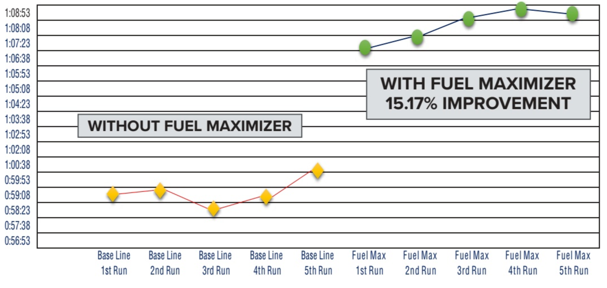
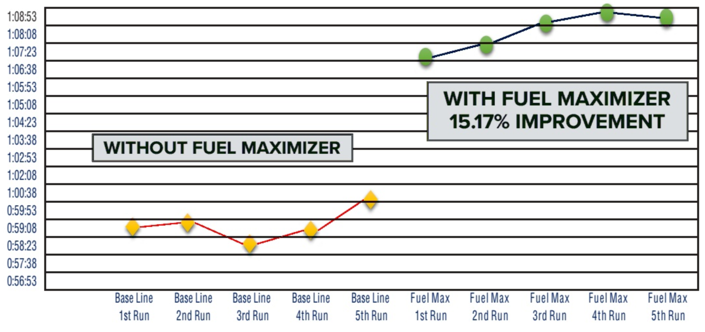
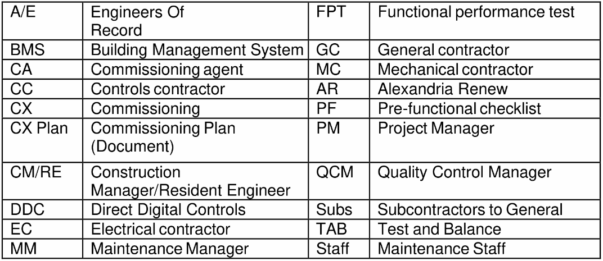
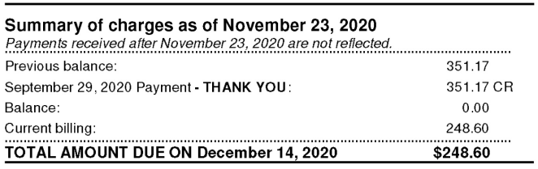

# 1. Overview

PDFSolid Conversion SDK is a high-performance library designed for extracting and transforming the data within your PDF files, such as text, images, tables, links, and annotations, into various file formats. The Conversion SDK retains the original document layout and the properties of the file data, helping you build a reliable document conversion workflow in C applications.

Effortlessly integrate the PDFSolid Conversion SDK into your C projects in just a few steps, and enable the following file format conversions:

- Convert PDF to Word (.docx)
- Convert PDF to Excel (.xlsx)
- Convert PDF to PowerPoint (.pptx)
- Convert PDF to HTML (.html)
- Convert PDF to CSV (.csv)
- Convert PDF to Image (.png, .jpg, .jpeg, .jpeg2000, .bmp, .tiff, .tga, .gif, .webp)
- Convert PDF to Plain Text (.txt)
- Convert PDF to Rich Text Format (.rtf)
- Convert PDF to Searchable PDF (.pdf)
- Convert PDF to OFD (.ofd)
- Convert PDF to Structured Data (.json)
- Convert PDF to Markdown (.md)
- Convert Word (.docx) to PDF (.pdf)
- Convert supported image inputs to images, including individual frames of multi-page TIFF files.

To enhance format conversion results, PDFSolid also provides AI-powered document tools with the following capabilities:

- Optical Character Recognition (OCR)
- Layout Analysis
- Table Recognition

## 1.1 Why PDFSolid Conversion SDK

- Mature Technology

  With years of technology accumulation, PDFSolid has established a complete mechanism of product iteration to offer a continuous guarantee for product competitiveness.

- Complete PDF and Format Conversion Functionalities

  The comprehensive feature set can meet diverse conversion needs and is easy for customers to use without training costs.

- High-quality Service

  Professional service and technical support can quickly respond to users' feedback through onsite service or remote support such as telephone and email.

- Independent Intellectual Property Rights

  The technology is independent and compliant with ISO, helping enterprises conduct international business without copyright risks.

## 1.2 PDFSolid Conversion SDK for C

The PDFSolid Conversion SDK is designed to convert PDF files into many other formats while preserving the original layout and formatting of the documents. In this guide, we will demonstrate how to use the C API exported by the SDK in Windows, Linux, and macOS projects.

## 1.3 License & Trial

The PDFSolid Conversion SDK is a commercial SDK that requires a license to grant developers the right to develop and distribute their applications. In development mode, each license is only valid for one device ID. PDFSolid provides flexible licensing models. Please contact [our marketing team](mailto:support@pdfsolid.com) for more information. Even if you have a license, it is prohibited to distribute any documents, sample code, or source code of the PDFSolid Conversion SDK to any third parties.

If you do not have a license, please contact the PDFSolid Team at support@pdfsolid.com to obtain a trial license for PDFSolid Conversion SDK.

# 2. Get Started

## 2.1 Requirements

Before starting, please make sure that you have met the following prerequisites.

### 2.1.1 Get PDFSolid License Key

PDFSolid provides two types of license key: 30-day free trial license and commercial license.

#### How to Get Free Trial License

Contact our sales team at support@pdfsolid.com and we will send you a 30-day free trial license for PDFSolid Conversion SDK.

#### How to Get Commercial License

PDFSolid Conversion SDK is a commercial SDK that requires a license for application release. Any documents, sample code, or source code distribution from the released package of PDFSolid to any third party is prohibited.

To get a commercial license for PDFSolid Conversion SDK, feel free to contact our sales team at support@pdfsolid.com.

For the C Conversion SDK, the commercial license must be bound to your developer device ID (How to find the developer device ID), and each license is only valid for one device ID in development mode.

### 2.1.2 Download Conversion SDK

Contact us at support@pdfsolid.com to obtain the PDFSolid C Conversion SDK.

### 2.1.3 System Requirements

| Platform | System Requirements | Development Environment | Notes |
| :------ | :------ | :------ | :------ |
| Windows | - Windows 7, 8, 10, and 11 (32-bit and 64-bit).<br /> - C++ 11 or above is required. | Install Visual Studio 2022 or later (ensure the ".NET Desktop Development" component is installed). | Samples have been tested on Windows 10 and 11. |
| Linux | - Linux x64.<br /> - C++ 11 or above is required. | / | Samples have been tested on Ubuntu 20.04. |
| Mac | - macOS 11.0 or later (Intel x86_64 and Apple Silicon arm64).<br /> - C++ 11 or above is required. | Install Xcode 13.0 or later. | Samples have been tested on Mac Intel and Mac Apple Silicon. |

## 2.2 SDK Package Structure

You can contact us at support@pdfsolid.com to get the PDF format conversion SDK package. The PDFSolid Conversion C SDK contains the following files:

- ***"doc"*** - API reference and developer guide.
- ***"include"*** - Header files for PDFSolid Conversion SDK C API.
- ***"lib"*** - PDFSolid dynamic libraries for supported architectures.
- ***"resource"*** - DocumentAI model resources.
- ***"samples"*** - Sample projects and scripts.
- ***"legal.txt"*** - Legal and copyright information.
- ***"release_notes.txt"*** - Release information.


**About model files:** the SDK package includes the base model `documentai.model` by default, so the default configuration does not require any additional download. Download extension model packages only when you need a higher-accuracy variant or extended features: `table_legacy.model` (high accuracy table recognition), `ocr_server.model` (high accuracy OCR, including Chinese, English, Japanese, and other languages), and `document_process.model` (orientation classification and correction). See [4.2 Set DocumentAI Model](#42-set-documentai-model) for details.

## 2.3 Apply the License Key

PDFSolid Conversion SDK currently supports offline authentication to verify license keys.

*Learn about:*

*What is the authentication mechanism of PDFSolid's license?*

### 2.3.1 Copy the License Key

Accurately obtaining the license key is crucial for applying the license.

1. In the email you received, locate the XML file containing the license key.
2. Open the XML file and determine the license type based on the `<type>` field. If `<type>online</type>` is present, it indicates an online license. If `<type>offline</type>` is present or if the field is absent, it indicates an offline license.

**Online License:**

```xml
<?xml version="1.0" encoding="UTF-8" standalone="no"?>
<license version="1">
    <platform>windows</platform>
    <starttime>xxxxxxxx</starttime>
    <endtime>xxxxxxxx</endtime>
    <type>online</type>
    <key>LICENSE_KEY</key>
</license>
```

**Offline License:**

```xml
<?xml version="1.0" encoding="UTF-8" standalone="no"?>
<license version="1">
    <platform>windows</platform>
    <starttime>xxxxxxxx</starttime>
    <endtime>xxxxxxxx</endtime>
    <key>LICENSE_KEY</key>
</license>
```

3. Copy the value located at the `LICENSE_KEY` position within the `<key>LICENSE_KEY</key>` field. This is your license key.

### 2.3.2 Apply the License Key

You can perform offline authentication using the following method:

```c
#include "pdfsolid_common_c.h"

const char* license = "LICENSE_KEY";
CSDKErrorCode code = CPDF_LicenseVerify(license, "device_id", "app_id");
if (code != e_CErrSuccess) {
    return code;
}
```

Before calling any conversion API, initialize the SDK resource directory:

```c
#include "pdfsolid_common_c.h"

#if defined(_WIN32)
#define CPDF_TEXT(text) L##text
#else
#define CPDF_TEXT(text) text
#endif

CPDF_Initialize(CPDF_TEXT("PDFSolid_Conversion_SDK/resource"));
```

### 2.3.3 Query the License Type

After the license is verified, call `CPDF_GetLicenseType` to get the type of the currently verified license. It does not verify the license again and does not consume page quota.

| Return value | Meaning |
| ---- | ---- |
| `e_CLicenseUnknown` (0) | No license has been verified, verification failed, or the SDK is releasing |
| `e_CLicenseTrial` (1) | Trial license |
| `e_CLicenseFormal` (2) | Formal license |

```c
CLicenseType type = CPDF_GetLicenseType();
if (type == e_CLicenseTrial) {
    // Trial license.
}
```

## 2.4 How to Run a Demo

### 2.4.1 Windows

PDFSolid Conversion SDK provides a demo in the ***"samples"*** folder. You can follow these steps to run the demo:

1. Load the Visual Studio solution file ***"demo_vs2022.sln"*** in the ***"samples"*** folder.
2. Build the demo by clicking **Build > Build Solution**. After the build is completed, the executable file ***".exe"*** will be generated in the ***"samples/bin"*** folder. The executable file name depends on the build configuration.
3. Double-click the executable file to run the demo.

Output files such as Word, Excel, and PowerPoint files will be generated in the ***"samples/output_files"*** folder.

### 2.4.2 Linux and Mac

PDFSolid Conversion SDK provides demos in the ***"samples"*** folder. Before running the demo, make sure you have configured your environment correctly and installed CMake 3.0 or higher. To run the demo, follow these steps:

1. Open a terminal window and navigate to the ***"samples"*** folder of the PDFSolid Conversion SDK package.
2. Enter the following command to run the demo.

```shell
./RunDemo.sh
```

Output files such as Word, Excel, and PowerPoint files will be generated in the ***"samples/output_files"*** folder.

# 3. C API Basics

## 3.1 Header Files

The C SDK exposes the following main headers:

| Header | Description |
| ------ | ----------- |
| `pdfsolid_common_c.h` | License, initialization, resource release, page count, version, and DocumentAI model configuration. |
| `pdfsolid_conversion_c.h` | PDF conversion APIs. |
| `pdfsolid_basictypes_c.h` | Error codes, conversion options, image types, OCR languages, and other public C types. |

**API List**

`pdfsolid_common_c.h`:

| API | Description |
| --- | ----------- |
| `CSDKErrorCode CPDF_LicenseVerify(const char* license, const char* device_id, const char* app_id)` | Verifies the license. `e_CErrSuccess` indicates success. See [2.3.2 Apply the License Key](#232-apply-the-license-key). |
| `CLicenseType CPDF_GetLicenseType(void)` | Returns the type of the currently verified license without verifying again or consuming quota. See [2.3.3 Query the License Type](#233-query-the-license-type). |
| `void CPDF_Initialize(PDFSOLID_STRING resource_path)` | Initializes the SDK. `resource_path` is the path of the resource directory in the SDK package. Call it before any conversion API. |
| `void CPDF_SetLogger(bool enable_info, bool enable_warning)` | Sets the log level. If `enable_info` is `true`, info, warning, and error messages are logged; otherwise, if `enable_warning` is `true`, warning and error messages are logged; if both are `false`, only error messages are logged. |
| `CSDKErrorCode CPDF_SetDocumentAIModel(PDFSOLID_STRING model_path, int gpu_id)` | Loads a DocumentAI model package and merges it with the capabilities already loaded. `gpu_id` is the GPU index; `-1` means no GPU is used. Returns `e_CErrInvalidArg` if `model_path` is empty, and `e_CErrConverting` while conversion tasks are running or a release is pending. See [4.2 Set DocumentAI Model](#42-set-documentai-model). |
| `void CPDF_SetDocumentAIModelCount(int layout_model_count, int table_model_count)` | Sets the number of Layout Analysis and Table Recognition model instances. Call it before conversions start; the call is ignored while conversion tasks are running or a release is pending. |
| `void CPDF_ReleaseDocumentAIModel(void)` | Releases all loaded DocumentAI models. To use AI features again, call `CPDF_SetDocumentAIModel` again. |
| `int CPDF_GetPageCount(PDFSOLID_STRING file_path, PDFSOLID_STRING password)` | Returns the number of pages of a PDF file. Returns `0` if the file cannot be opened (for example, a wrong password), and `-1` while library resources are being released or configured. |
| `int CPDF_GetRemainingPageQuota(void)` | Returns the remaining page quota: `>= 0` is the number of remaining pages, `-1` means not initialized, `-2` means unlimited, and `-3` means the quota file is corrupted. |
| `void CPDF_GetVersion(char* version)` | Writes the SDK version string (for example `"1.3.0"`) into a caller-allocated buffer, which must be large enough for the string (for example 32 bytes). |
| `void CPDF_Release(void)` | Releases all resources occupied by the SDK. See [4.24 Releasing Library Resources](#424-releasing-library-resources). |

`pdfsolid_conversion_c.h`: except Word to PDF, all conversion APIs share the same signature:

```c
CSDKErrorCode CPDF_StartPDFToXxx(
    PDFSOLID_STRING file_path,    // Input file path
    PDFSOLID_STRING password,     // Password for opening the PDF; pass an empty string if none
    PDFSOLID_STRING output_path,  // Output path
    CConvertOption options,        // Conversion options
    CConvertCallback* callback);   // Optional callbacks; pass NULL if not needed
```

| API | Output | Section |
| --- | ------ | ------- |
| `CPDF_StartPDFToWord` | Word (.docx) | [4.13](#413-convert-pdf-to-word) |
| `CPDF_StartPDFToExcel` | Excel (.xlsx) / CSV | [4.14](#414-convert-pdf-to-excel), [4.17](#417-convert-pdf-to-csv) |
| `CPDF_StartPDFToPpt` | PowerPoint (.pptx) | [4.15](#415-convert-pdf-to-powerpoint) |
| `CPDF_StartPDFToHtml` | HTML (.html) | [4.16](#416-convert-pdf-to-html) |
| `CPDF_StartPDFToImage` | Images | [4.18](#418-convert-pdf-to-image) |
| `CPDF_StartPDFToRtf` | RTF (.rtf) | [4.19](#419-convert-pdf-to-rtf) |
| `CPDF_StartPDFToTxt` | Text (.txt) | [4.20](#420-convert-pdf-to-txt) |
| `CPDF_StartPDFToSearchablePDF` | Searchable PDF (.pdf) | [4.21](#421-convert-pdf-to-searchable-pdf) |
| `CPDF_StartPDFToOfd` | OFD (.ofd) | [4.22](#422-convert-pdf-to-ofd) |
| `CPDF_StartPDFToJson` | JSON (.json) | [5.1](#51-extract-pdf-to-json) |
| `CPDF_StartPDFToMarkdown` | Markdown (.md) | [5.2](#52-extract-pdf-to-markdown) |
| `CPDF_StartWordToPDF` | PDF (the input is a Word document; different signature) | [4.23](#423-convert-word-to-pdf) |

For `CConvertCallback` (`progress`, `cancel`, `handle`, and the custom AI callbacks), see [4.3](#43-get-conversion-progress), [4.4](#44-cancel-conversion-task), and [4.11](#411-use-custom-ai-models-via-callbacks).

Most conversion code needs at least:

```c
#include <stdbool.h>
#include <string.h>

#include "pdfsolid_common_c.h"
#include "pdfsolid_conversion_c.h"
```

## 3.2 Platform String Type

Most file path parameters use `PDFSOLID_STRING`:

```c
#if defined(_WIN32)
#define PDFSOLID_STRING const wchar_t*
#else
#define PDFSOLID_STRING const char*
#endif
```

On Windows, pass wide-character strings such as `L"input.pdf"`. On Linux and macOS, pass UTF-8 `const char*` strings. For portable string literals in sample code, this guide uses the following helper macro (defined by this guide, not provided by the SDK; copy it into your project if needed):

```c
#if defined(_WIN32)
#define CPDF_TEXT(text) L##text
#else
#define CPDF_TEXT(text) text
#endif
```

`CPDF_LicenseVerify` is an exception: its `license`, `device_id`, and `app_id` parameters are always `const char*`.

## 3.3 Conversion Option Initialization

`CConvertOption` is a plain C structure. It does not have a constructor, so initialize it before use. The samples in this guide use the following helper function (defined by this guide, not provided by the SDK), which returns the same default values as `CPDF_CONVERT_OPTION_DEFAULT`:

```c
#include <string.h>

static CConvertOption CPDF_DefaultConvertOption(void)
{
    CConvertOption option;
    memset(&option, 0, sizeof(option));

    option.enable_ai_layout = true;
    option.enable_ai_table_recognition = true;
    option.contain_image = true;
    option.contain_page_background_image = true;
    option.json_contain_table = true;
    option.contain_annotation = true;
    option.transparent_text = true;
    option.txt_table_format = true;
    option.formula_to_image = true;
    option.auto_create_folder = true;
    option.image_scaling = 4.0f;
    option.page_layout_mode = e_PageLayoutModeFlow;
    option.excel_worksheet_option = e_CForTable;
    option.html_option = e_CSinglePage;
    option.ocr_option = e_CAll;
    option.image_color_mode = e_CColor;
    option.image_type = e_CJPG;
    option.table_recognition_accuracy = e_CBalanced;
    option.word_pdf_bookmark_mode = e_CWordPdfBookmarkNone;

    return option;
}
```

The header also provides the `CPDF_CONVERT_OPTION_DEFAULT` macro, which expands to the same default values:

```c
CConvertOption option = CPDF_CONVERT_OPTION_DEFAULT;
```

You can also zero-initialize the structure and explicitly set every option you rely on:

```c
CConvertOption option = {0};
option.contain_image = true;
option.page_layout_mode = e_PageLayoutModeFlow;
```

> **Notice:** A zero-initialized `CConvertOption` has `table_recognition_accuracy` set to `0`, which is `e_CHighAccuracy`, whereas the default is `e_CBalanced`. If you zero-initialize the structure, set `table_recognition_accuracy` explicitly (see [4.10 Table Recognition](#410-table-recognition)).

For string fields such as `page_ranges` and `font_name`, use bounded copy functions in production code. The sample snippets use `strcpy` only for clarity.

### CConvertOption Fields

The defaults below are the initial values in `CPDF_CONVERT_OPTION_DEFAULT`:

| Field | Type | Default | Description |
| ----- | ---- | ------- | ----------- |
| `enable_ai_layout` | `bool` | `true` | Whether to enable AI layout analysis. Layout analysis is enabled automatically when OCR is enabled. |
| `enable_ai_table_recognition` | `bool` | `true` | Whether to enable AI table recognition. Takes effect only when layout analysis is active. |
| `contain_image` | `bool` | `true` | Whether to include images in the output. Takes effect only when `enable_ocr` is `false`. |
| `contain_page_background_image` | `bool` | `true` | Whether to include the page background image in the output. Takes effect only when `enable_ocr` is `true`. |
| `json_contain_table` | `bool` | `true` | Whether to extract tables when converting PDF to JSON. |
| `contain_annotation` | `bool` | `true` | Whether to include annotations. |
| `excel_all_content` | `bool` | `false` | Whether to write content other than tables, such as text and images, when converting PDF to Excel. |
| `excel_csv_format` | `bool` | `false` | Whether to save tables in CSV format when converting PDF to Excel. |
| `enable_ocr` | `bool` | `false` | Whether to enable OCR. |
| `transparent_text` | `bool` | `true` | Whether the text layer in the output document is transparent (used for Searchable PDF and OFD). |
| `txt_table_format` | `bool` | `true` | Whether to write table text following the table structure when converting PDF to TXT. |
| `image_path_enhance` | `bool` | `false` | Whether to enhance the display of paths when converting PDF to images. |
| `formula_to_image` | `bool` | `true` | Whether to convert formulas to images. |
| `auto_create_folder` | `bool` | `true` | Whether to automatically create a folder when multiple files are output. |
| `output_document_per_page` | `bool` | `false` | Whether to output one document per page. |
| `language_count` | `int` | `0` | Number of languages in the `languages` array. |
| `image_scaling` | `float` | `4.0` | Scaling of the output images. `1.0` keeps the original page size. |
| `page_layout_mode` | `CPageLayoutMode` | `e_PageLayoutModeFlow` | Page layout mode. See [4.7](#47-page-layout-mode). |
| `excel_worksheet_option` | `CExcelWorksheetOption` | `e_CForTable` | How Excel worksheets are created. See [4.14](#414-convert-pdf-to-excel). |
| `html_option` | `CHtmlOption` | `e_CSinglePage` | HTML output mode. See [4.16](#416-convert-pdf-to-html). |
| `ocr_option` | `COCROption` | `e_CAll` | OCR scope. See [4.8](#48-ocr). |
| `image_color_mode` | `CImageColorMode` | `e_CColor` | Color mode of the output images. |
| `image_type` | `CImageType` | `e_CJPG` | Format of the output images. |
| `font_name` | `char[256]` | Empty | Font name used in the output document, for example `"Arial"`. See [4.12](#412-output-font-option). |
| `page_ranges` | `char[256]` | Empty | Pages to convert, for example `"1-3,5,7-9"`. Empty converts all pages. |
| `languages` | `COCRLanguage*` | `NULL` | Array of `language_count` OCR languages; at most 32 are used. If OCR is enabled and no language is given, English is used. |
| `enable_document_orientation_classification` | `bool` | `false` | Whether to classify and correct the document orientation before OCR. Takes effect only when `enable_ocr` is `true`; requires `document_process.model`. |
| `enable_document_dewarp` | `bool` | `false` | Whether to apply document dewarp before OCR. Takes effect only when `enable_ocr` is `true`; requires `document_process.model`. |
| `enable_auto_page_size` | `bool` | `false` | For image input, matches the output page to the nearest standard paper size. See [4.18](#418-convert-pdf-to-image). |
| `custom_page_width` | `float` | `0` | For image input, the output page width in points. `0` means not specified. |
| `custom_page_height` | `float` | `0` | For image input, the output page height in points. |
| `table_recognition_accuracy` | `CTableRecognitionAccuracy` | `e_CBalanced` | Table recognition model profile. See [4.10](#410-table-recognition). |
| `word_pdf_bookmark_mode` | `CWordPdfBookmarkMode` | `e_CWordPdfBookmarkNone` | How the PDF bookmarks are generated. Only takes effect for Word to PDF; see [4.23](#423-convert-word-to-pdf). |

### Enumerations

| Enumeration | Values |
| ----------- | ------ |
| `CPageLayoutMode` | `e_PageLayoutModeBox` (box layout), `e_PageLayoutModeFlow` (flow layout) |
| `COCROption` | `e_CInvalidCharacter`, `e_CScanPage`, `e_CInvalidCharacterAndScanPage`, `e_CAll`; see [4.8](#48-ocr) |
| `CExcelWorksheetOption` | `e_CForTable`, `e_CForPage`, `e_CForDocument`; see [4.14](#414-convert-pdf-to-excel) |
| `CHtmlOption` | `e_CSinglePage`, `e_CSinglePageWithBookmark`, `e_CMultiPage`, `e_CMultiPageWithBookmark`; see [4.16](#416-convert-pdf-to-html) |
| `CImageColorMode` | `e_CColor` (color), `e_CGray` (grayscale), `e_CBinary` (black and white) |
| `CImageType` | `e_CJPG`, `e_CJPEG`, `e_CJPEG2000`, `e_CPNG`, `e_CBMP`, `e_CTIFF`, `e_CTGA`, `e_CGIF`, `e_CWEBP` |
| `CTableRecognitionAccuracy` | `e_CHighAccuracy` (0, high accuracy), `e_CBalanced` (1, balanced) |
| `CWordPdfBookmarkMode` | `e_CWordPdfBookmarkNone`, `e_CWordPdfBookmarkHeadings`, `e_CWordPdfBookmarkWordBookmarks`; see [4.23](#423-convert-word-to-pdf) |
| `COCRLanguage` | See [4.8](#48-ocr). |

## 3.4 Error Codes

Most C APIs return `CSDKErrorCode`. `e_CErrSuccess` indicates success.

| Error Code | Value | Meaning |
| ---------- | ----- | ------- |
| `e_CErrSuccess` | 0 | Success. |
| `e_CErrCancel` | 1 | The conversion was canceled. |
| `e_CErrFile` | 2 | The file cannot be found or opened. |
| `e_CErrPDFPassword` | 3 | The password is invalid. |
| `e_CErrPDFPage` | 4 | A PDF page failed to load. |
| `e_CErrPDFFormat` | 5 | The format is invalid, or the file is corrupted. |
| `e_CErrPDFSecurity` | 6 | The PDF is encrypted by an unsupported security handler. |
| `e_CErrOutOfMemory` | 7 | Out of memory. For Word to PDF, it also means that the diagnostics buffer cannot hold the complete diagnostics. |
| `e_CErrIO` | 8 | System I/O error. |
| `e_CErrCompress` | 9 | Folder compression failed. |
| `e_CErrLicenseInvalid` | 20 | The license is invalid. |
| `e_CErrLicenseExpire` | 21 | The license has expired. |
| `e_CErrLicenseUnsupportedPlatform` | 22 | The license does not support the current platform. |
| `e_CErrLicenseUnsupportedID` | 23 | The license does not support the application ID. |
| `e_CErrLicenseUnsupportedDevice` | 24 | The license does not support the device ID. |
| `e_CErrLicensePermissionDeny` | 25 | The license does not have the function permission. |
| `e_CErrLicenseUninitialized` | 26 | The license has not been initialized. |
| `e_CErrLicenseIllegalAccess` | 27 | Illegal access to the API. |
| `e_CErrLicenseFileReadFailed` | 28 | Failed to read the license file. |
| `e_CErrLicenseOCRPermissionDeny` | 29 | The license does not have OCR permission. |
| `e_CErrLicenseConcurrencyExceeded` | 30 | The current conversion concurrency exceeds the license limit. |
| `e_CErrLicensePageLimitExceeded` | 31 | The converted pages exceed the license limit. |
| `e_CErrLicenseQuotaCorrupted` | 32 | The quota persistence file has been tampered with. |
| `e_CErrNoTable` | 40 | No tables were found in the source file. |
| `e_CErrOCRFailure` | 41 | Failed to call OCR recognition. |
| `e_CErrConverting` | 60 | A conversion task is running (for example, loading a model during a conversion). |
| `e_CErrInvalidArg` | 80 | Invalid argument. |
| `e_CErrInvalidHandle` | 81 | The handle is invalid, possibly uninitialized or already released. |
| `e_CErrModelInvalidFormat` | 82 | The model file format is invalid or corrupted. |
| `e_CErrModelFunctionUnsupported` | 83 | The model does not support the requested function. |
| `e_CErrModelFormatUnsupported` | 84 | The model format is not supported. |
| `e_CErrModelSDKMismatch` | 85 | The model does not match the current SDK version. |
| `e_CErrImageDataEmpty` | 86 | The image data is empty. |
| `e_CErrImageWHError` | 87 | The image width or height is invalid. |
| `e_CErrImageUnsupportedFormat` | 88 | The image format is not supported. |
| `e_CErrImageInvalid` | 89 | The image is invalid or corrupted. |
| `e_CErrExpire` | 90 | The resource (for example, the license) has expired. |
| `e_CErrMissingArg` | 91 | A required argument is missing. |
| `e_CErrLicenseUnsupportedAPI` | 92 | The current license does not support calling this API. |
| `e_CErrLicenseMismatch` | 93 | The license does not match the device, module, or version. |
| `e_CErrInvalidTable` | 94 | The table data is invalid or empty. |
| `e_CErrUnsupportedFeature` | 95 | The input uses a feature that cannot be fully reproduced, or the target format cannot carry the input content. A usable output may still exist (Word to PDF normally still produces the PDF). See [4.18 Convert PDF to Image](#418-convert-pdf-to-image) and [4.23 Convert Word to PDF](#423-convert-word-to-pdf). |
| `e_CErrUnknown` | 100 | Unknown error. |

Always check the returned error code after calling a conversion API.

# 4. Conversion Guides

In addition to PDF export, the SDK converts Word (`.docx`) to PDF with optional page ranges and bookmarks. See [Convert Word to PDF](#423-convert-word-to-pdf).

PDFSolid Conversion SDK allows developers to use simple C APIs to convert PDFs to common formats such as Word, Excel, PowerPoint, HTML, CSV, PNG, JPEG, RTF, TXT, Searchable PDF, OFD, JSON, and Markdown. It also provides conversion options, such as whether to include images or annotations, whether to enable OCR, and whether to enable layout analysis.

## 4.1 Initialize Library Resources

### Overview

Initialize the necessary file and memory resources required by the PDFSolid Conversion SDK.

### Notes

- You must initialize SDK resources before calling any conversion interface.
- When using OCR, Layout Analysis, Table Recognition, PDF to Searchable PDF, or PDF to OFD, make sure the DocumentAI model resources in the `resource` directory are available.

### Example

```c
CPDF_Initialize(CPDF_TEXT("PDFSolid_Conversion_SDK/resource"));
```

## 4.2 Set DocumentAI Model

### Overview

Before using OCR, Layout Analysis, Table Recognition, PDF to Searchable PDF, or PDF to OFD, set the DocumentAI model path first.

`CPDF_SetDocumentAIModel` supports the `gpu_id` parameter to specify the GPU device index for the AI model. When `gpu_id` is `-1`, GPU acceleration is disabled.

Model files are delivered as packages: one base package and several extension packages. Every call to `CPDF_SetDocumentAIModel` loads only the capabilities contained in the given file and **merges** them with the capabilities that are already loaded; it does not replace them.

### Example

```c
CSDKErrorCode code = CPDF_SetDocumentAIModel(CPDF_TEXT("path/documentai.model"), -1);
if (code != e_CErrSuccess) {
    return code;
}
```

### Model Packages

**The SDK package includes the base model `documentai.model` by default. The default configuration does not require any additional download.** Download an extension package, place it in a directory of your choice, and load it with `CPDF_SetDocumentAIModel` only when you need a higher-accuracy variant or extended features.

| File | Size | Purpose | Acquisition / When it is needed |
| ---- | ---- | ------- | ------------------------------- |
| `documentai.model` | About 230 MB | Base package: layout analysis, table recognition (balanced profile), and all basic OCR languages. | Included in the SDK package by default. Required by every AI feature (layout analysis, OCR, table recognition). |
| `table_legacy.model` | About 270 MB | Table extension package: resources such as wired/wireless table detection required by the high accuracy profile. | Additional download. Required only when `table_recognition_accuracy` is `e_CHighAccuracy`; not needed for the default balanced profile. |
| `ocr_server.model` | About 139 MB | High accuracy OCR enhancement package, including Chinese, English, Japanese, and other languages. | Additional download. Needed when you require higher OCR accuracy. |
| `document_process.model` | About 37 MB | Document orientation classification and skew correction. | Additional download. Required when `enable_document_orientation_classification` (orientation classification) or `enable_document_dewarp` (dewarp) is used. |

The four files total about 676 MB. **If you do not need the extra features, you do not need to download any extension package**: the default configuration uses only the `documentai.model` included in the SDK package.

### Load Model Packages Incrementally

All model packages are loaded through the same interface:

```c
// Load the base package first.
CPDF_SetDocumentAIModel(CPDF_TEXT("path/documentai.model"), -1);
// Load extension packages when needed; capabilities that are already loaded are kept.
CPDF_SetDocumentAIModel(CPDF_TEXT("path/table_legacy.model"), -1);
CPDF_SetDocumentAIModel(CPDF_TEXT("path/document_process.model"), -1);
```

- Each call loads only the capabilities contained in that file and merges them with the loaded capabilities. The loading order is not restricted.
- `gpu_id` specifies the GPU index used by the AI model. `-1` means no GPU is used.
- If a package fails to load, the capabilities loaded before are **kept** and the specific error code is returned. The SDK does not silently degrade.
- `CPDF_ReleaseDocumentAIModel` releases all loaded models. To use AI features again, load the models again.
- While conversion tasks are running, or while a release has not finished, loading a model again is rejected and `e_CErrConverting` is returned.

### Version Compatibility

- Model packages must match the SDK version. The `documentai.model` included in the SDK package is the version that matches 1.3.0. **Please also download the 1.3.0 version of any extension package.**
- The `documentai.model` of 1.2.0 and earlier versions **does not contain** the resources required by the balanced profile, while 1.3.0 keeps the same file name. **If you copied an old `documentai.model` into your own deployment directory or project, overwrite it with the new file from the 1.3.0 SDK package when upgrading. Do not keep using the old file with the same name.** Loading an old model returns an error; the SDK does not fall back to the high accuracy profile automatically.
- Do not replace only the dynamic library or only the model file. Update them together.

### Troubleshooting

| Symptom | Possible Cause |
| ------- | -------------- |
| `CPDF_SetDocumentAIModel` returns an error | The path is wrong; the model file does not match the SDK version; the file is incomplete (interrupted download). |
| Tables look different from (or worse than) expected after selecting `e_CHighAccuracy` | `table_legacy.model` is not loaded (tables fell back to rule-based recognition) |
| `e_CErrLicenseOCRPermissionDeny` (29) is returned during conversion | The license does not include OCR permission. This is not related to the model. |

### Set AI Model Instance Count

If you need to control the number of Layout Analysis and Table Recognition model instances, call the following interface:

```c
CPDF_SetDocumentAIModelCount(1, 1);
```

The first parameter indicates the number of Layout Analysis model instances, and the second parameter indicates the number of Table Recognition model instances.

### Use Your Own AI Engine (SDK v1.1.0+)

This option is available only in SDK v1.1.0 or later. If you prefer to run OCR, Layout Analysis, or Table Recognition with your own model or a third-party service instead of the bundled DocumentAI model, the SDK exposes callback hooks on `CConvertCallback` that let you supply the results as JSON. See [4.11 Use Custom AI Models via Callbacks](#411-use-custom-ai-models-via-callbacks) for details. When all capabilities you need are covered by your own callbacks, `CPDF_SetDocumentAIModel` does not have to be called.

### OpenVINO Acceleration Package

If your device uses an Intel processor, you can deploy the optional OpenVINO acceleration package to speed up AI recognition such as OCR. Once the package is deployed, the SDK automatically uses the OpenVINO backend when it loads the DocumentAI model, **with no code changes and no extra settings**.

- **Applicability:** Windows x64 with an Intel CPU. The package only affects the speed of AI inference (such as OCR recognition); it does not change any conversion API or conversion option.
- **Get the package:** Download the OpenVINO acceleration package that matches your SDK version. Do not mix files from different versions.
- **Deployment:** Extract the package and copy **all files** in it to the directory that contains the SDK dynamic libraries (the same directory as the `onnxruntime` runtime library). Then load the model with `CPDF_SetDocumentAIModel` and run conversions as usual.

Notice:

- If the package is missing, incomplete, or does not match the SDK version, the SDK automatically uses the default CPU backend. Conversion continues normally and no error is reported for this reason.
- Deploy the whole package. Do not copy or replace only some of its files.
- Deploy the package before the model is loaded. A model that is already loaded does not switch backends, so restart the program or reload the model after deployment.
- The OpenVINO backend uses more memory. The actual speed-up depends on the processor model, document content, and thread settings, and not every scenario becomes faster.
- To stop using acceleration, delete these files. The SDK then returns to the default CPU backend.

## 4.3 Get Conversion Progress

PDFSolid Conversion SDK obtains conversion progress through the `progress` callback in `CConvertCallback`. The following example demonstrates how to get conversion progress while performing a PDF to Word task:

```c
#include <stdio.h>

static void Progress(int current_page_count, int total_page_count)
{
    printf("progress: %d / %d\n", current_page_count, total_page_count);
}

CConvertOption option = CPDF_DefaultConvertOption();

CConvertCallback callback = {0};
callback.progress = Progress;

CSDKErrorCode code = CPDF_StartPDFToWord(
    CPDF_TEXT("input.pdf"),
    CPDF_TEXT("password"),
    CPDF_TEXT("path/output.docx"),
    option,
    &callback);
```

The `handle` field is maintained internally by the SDK during conversion, so it should be initialized to `NULL` when passed in.

## 4.4 Cancel Conversion Task

PDFSolid Conversion SDK supports interrupting an ongoing conversion task through the `cancel` callback in `CConvertCallback`. When the `cancel` callback returns `true`, the current conversion task stops as soon as possible.

```c
static bool Cancel(void)
{
    return false;
}

CConvertOption option = CPDF_DefaultConvertOption();

CConvertCallback callback = {0};
callback.cancel = Cancel;

CSDKErrorCode code = CPDF_StartPDFToWord(
    CPDF_TEXT("input.pdf"),
    CPDF_TEXT("password"),
    CPDF_TEXT("path/output.docx"),
    option,
    &callback);
```

If you need to cancel the conversion at a specific time, return `true` from `Cancel` based on external state.

## 4.5 Select Page Range for Conversion

PDFSolid Conversion SDK supports converting a specified page range. When an empty string is passed, all pages will be converted. If the page range exceeds one page, you can enable `output_document_per_page` to output each PDF page as a separate file.

```c
CConvertOption option = CPDF_DefaultConvertOption();
option.output_document_per_page = true;
strcpy(option.page_ranges, "1-3,5,7-9");
```

## 4.6 Contain Image and Annotation Options

### Overview

When converting PDF documents into various formats, PDFSolid Conversion SDK offers two common options: whether images are included in the generated document, and whether annotations from the PDF file are retained.

- When `contain_image` is enabled, the SDK extracts images from the PDF document and embeds them in the corresponding pages and positions in the output file. For areas with overlapping images, the SDK merges these images into one image and embeds it at the correct location.
- When `contain_annotation` is enabled, most annotations are converted into raster images and embedded at the corresponding positions. Certain types of annotations, such as highlights, underlines, strikeouts, and squiggly lines, are converted into native formatting equivalents in Word, PowerPoint, and HTML documents when possible.

These options are commonly used in the following conversions:

- PDF to Word
- PDF to Excel
- PDF to PowerPoint
- PDF to HTML
- PDF to RTF
- Extract PDF to JSON
- Extract PDF to Markdown

### Sample

```c
CConvertOption option = CPDF_DefaultConvertOption();
option.contain_image = true;
option.contain_annotation = true;

CSDKErrorCode code = CPDF_StartPDFToWord(
    CPDF_TEXT("input.pdf"),
    CPDF_TEXT("password"),
    CPDF_TEXT("path/output.docx"),
    option,
    NULL);
```

## 4.7 Page Layout Mode

In certain formats, the page layout mode plays a key role in the quality of the converted document. PDFSolid Conversion SDK supports two layout modes: Flow Layout and Box Layout.

- **Flow Layout:** This layout uses paragraph indentations, columns, and tab positions to adjust content. Its main advantage is flexibility. Content can flow automatically as the document is edited and can adapt to different screen sizes.
- **Box Layout:** This layout is based on the PDF fixed-page model and accurately positions text, images, and tables on the page using coordinates. It is useful for documents that require high-precision reproduction, such as contracts, design drafts, and academic papers.

Page layout modes are commonly used in the following conversions:

- PDF to Word
- PDF to HTML

### Sample

```c
CConvertOption option = CPDF_DefaultConvertOption();

option.page_layout_mode = e_PageLayoutModeFlow;
CPDF_StartPDFToWord(CPDF_TEXT("input.pdf"), CPDF_TEXT("password"), CPDF_TEXT("path/flow.docx"), option, NULL);

option.page_layout_mode = e_PageLayoutModeBox;
CPDF_StartPDFToWord(CPDF_TEXT("input.pdf"), CPDF_TEXT("password"), CPDF_TEXT("path/box.docx"), option, NULL);
```

## 4.8 OCR

### Overview

OCR (Optical Character Recognition) converts images of typed, handwritten, or printed text into machine-encoded text.

OCR is commonly used for text recognition and extraction from the following types of documents:

- Non-editable scanned PDF files.
- Photographs of documents.
- Scene photos such as advertising layouts and signboards.
- Identification cards, passports, vehicle license plates, invoices, bills, and receipts.

The following features support OCR:

- PDF to Word
- PDF to Excel
- PDF to PowerPoint
- PDF to HTML
- PDF to RTF
- PDF to TXT
- PDF to CSV
- PDF to Searchable PDF
- PDF to OFD
- Extract PDF to JSON
- Extract PDF to Markdown

### OCR Language

Pass OCR languages through `CConvertOption.languages` and set `CConvertOption.language_count` for each conversion task.

```c
COCRLanguage languages[] = {e_CENGLISH};

CConvertOption option = CPDF_DefaultConvertOption();
option.enable_ocr = true;
option.languages = languages;
option.language_count = 1;

CPDF_StartPDFToWord(CPDF_TEXT("word.pdf"), CPDF_TEXT("password"), CPDF_TEXT("path/output.docx"), option, NULL);
```

Supported C enum values include:

| Enum | Description |
| ---- | ----------- |
| `e_CCHINESE` | Chinese Simplified |
| `e_CCHINESE_TRA` | Chinese Traditional |
| `e_CENGLISH` | English |
| `e_CKOREAN` | Korean |
| `e_CJAPANESE` | Japanese |
| `e_CLATIN` | Latin script languages |
| `e_CDEVANAGARI` | Devanagari |
| `e_CCYRILLIC` | Cyrillic |
| `e_CARABIC` | Arabic |
| `e_CTAMIL` | Tamil |
| `e_CTELUGU` | Telugu |
| `e_CKANNADA` | Kannada |
| `e_CTHAI` | Thai |
| `e_CGREEK` | Greek |
| `e_CEslav` | Eslav |
| `e_CAUTO` | Automatically select language |
| `e_CUNKNOWN` | Unknown language |

If OCR is enabled and no language is given, English is used.

### OCR Options

Different OCR options can be selected according to actual needs:

- `e_CInvalidCharacter`: Recognizes invalid or garbled characters in the PDF document through OCR, while normal characters are not processed by OCR.
- `e_CScanPage`: Recognizes scanned pages in the PDF document through OCR, while editable pages are not processed by OCR.
- `e_CInvalidCharacterAndScanPage`: Recognizes both invalid characters and scanned pages in the PDF document through OCR.
- `e_CAll`: Recognizes all pages and characters in the PDF document through OCR (default).

### Preserve Page Background

When OCR is enabled, you can enable `contain_page_background_image` to preserve the original page background image of the PDF. If it is disabled, the image result detected during page layout analysis will be retained.

### Notice

- The quality of the OCR result depends on the quality of the input image. A good rule of thumb is that the more pixels in the character shapes, the better. The ideal image is a grayscale image with a resolution around 300 DPI.
- When performing OCR, make sure the OCR language setting matches the language in the PDF document to achieve the best OCR conversion quality.
- OCR functionality currently does not support operating systems lower than Windows 10.

### Converting Images to Other Document Formats

The OCR function also supports converting input images into Word, Excel, PowerPoint, HTML, CSV, RTF, TXT, JSON, and other formats.

```c
CPDF_SetDocumentAIModel(CPDF_TEXT("path/documentai.model"), -1);

COCRLanguage languages[] = {e_CENGLISH};

CConvertOption option = CPDF_DefaultConvertOption();
option.enable_ocr = true;
option.languages = languages;
option.language_count = 1;

CPDF_StartPDFToWord(CPDF_TEXT("input.png"), CPDF_TEXT(""), CPDF_TEXT("path/output.docx"), option, NULL);
```

## 4.9 Layout Analysis

### Overview

Layout analysis uses AI technology to parse and understand the structure of a document layout. It extracts text, images, tables, layers, and other data from input documents.

Features that support Layout Analysis:

- PDF to Word
- PDF to Excel
- PDF to PowerPoint
- PDF to HTML
- PDF to RTF
- PDF to TXT
- PDF to CSV
- Extract PDF to JSON
- Extract PDF to Markdown

### Notice

- You need to load the DocumentAI model before using layout analysis, or plug in your own AI engine via callbacks described in [4.11 Use Custom AI Models via Callbacks](#411-use-custom-ai-models-via-callbacks).
- When OCR is enabled, layout analysis is automatically enabled.
- AI table recognition is a separate stage controlled by `enable_ai_table_recognition`.

### Sample

```c
CPDF_SetDocumentAIModel(CPDF_TEXT("path/documentai.model"), -1);

CConvertOption option = CPDF_DefaultConvertOption();
option.enable_ai_layout = true;

CPDF_StartPDFToWord(CPDF_TEXT("word.pdf"), CPDF_TEXT("password"), CPDF_TEXT("path/output.docx"), option, NULL);
```

## 4.10 Table Recognition

### Overview

Table Recognition reconstructs the internal structure of tables detected during layout analysis, including rows, columns, merged cells, and cell boundaries, so that the converted document preserves the original tabular semantics instead of producing a flat grid of text fragments.

It is controlled by the independent option `enable_ai_table_recognition`, which is enabled by default in the helper in this guide. The table model is invoked for table regions detected by layout analysis.

Typical scenarios that benefit from Table Recognition:

- Borderless or partially bordered tables.
- Tables with merged header cells, multi-row headers, or spanning cells.
- Scanned tables processed by OCR.

### Notice

- Table Recognition runs only when layout analysis is active, either through `enable_ai_layout = true` or implicitly through `enable_ocr = true`.
- You need to load the DocumentAI model before using Table Recognition, or plug in your own table model via callbacks described in [4.11 Use Custom AI Models via Callbacks](#411-use-custom-ai-models-via-callbacks).
- Set `enable_ai_table_recognition = false` to disable the table model.
- The number of Table Recognition model instances can be tuned through the second parameter of `CPDF_SetDocumentAIModelCount`.

### Table Model Profile

`CConvertOption.table_recognition_accuracy` selects the resource profile used by table recognition. Its type is the enumeration `CTableRecognitionAccuracy`:

| Value | Meaning |
| ----- | ------- |
| `e_CHighAccuracy` (0) | Prioritizes recognition accuracy and may use more resources. This was the default behavior of 1.2.0. |
| `e_CBalanced` (1) | Balances recognition accuracy, resource usage, and throughput. **This is the default since 1.3.0.** |

- Models of the two profiles can be loaded at the same time. Each conversion task uses the profile set in its own `table_recognition_accuracy`.
- `e_CHighAccuracy` requires `table_legacy.model` to be loaded in addition to the base model (see [4.2 Set DocumentAI Model](#42-set-documentai-model)). If it is not loaded, the conversion still succeeds, but tables are recognized with the rule-based method instead, so the result differs from the high-accuracy result.
- A profile name does not guarantee a better result for every document.
- `CPDF_DefaultConvertOption` and `CPDF_CONVERT_OPTION_DEFAULT` use `e_CBalanced`, but a zero-initialized structure uses `e_CHighAccuracy` (value 0).

### Sample

```c
CPDF_SetDocumentAIModel(CPDF_TEXT("path/documentai.model"), -1);

CConvertOption option = CPDF_DefaultConvertOption();
option.enable_ai_layout = true;
option.enable_ai_table_recognition = true;

CPDF_StartPDFToWord(CPDF_TEXT("word.pdf"), CPDF_TEXT("password"), CPDF_TEXT("path/output.docx"), option, NULL);
```

To use the high accuracy profile, load the table extension package as well and select the profile:

```c
CPDF_SetDocumentAIModel(CPDF_TEXT("path/documentai.model"), -1);
CPDF_SetDocumentAIModel(CPDF_TEXT("path/table_legacy.model"), -1);

CConvertOption option = CPDF_DefaultConvertOption();
option.enable_ai_layout = true;
option.table_recognition_accuracy = e_CHighAccuracy;

CPDF_StartPDFToWord(CPDF_TEXT("word.pdf"), CPDF_TEXT("password"), CPDF_TEXT("path/output.docx"), option, NULL);
```

## 4.11 Use Custom AI Models via Callbacks

### Overview

Starting with SDK v1.1.0, PDFSolid Conversion SDK exposes a callback-based extension point that lets you plug in your own AI inference engine for OCR, Layout Analysis, and Table Recognition. Instead of relying on the built-in DocumentAI model loaded by `CPDF_SetDocumentAIModel`, you can run inference with any model or service and return the result to the SDK as a JSON string.

When the relevant callback pair is registered on `CConvertCallback`, the SDK skips its built-in model invocation for that capability and consumes your JSON output instead. If a pair is left as `NULL`, the SDK falls back to the built-in DocumentAI model when available.

### Callback Pairs

Each AI capability uses two callbacks: a trigger callback invoked by the SDK with the path to a page image saved as PNG in a temporary directory, and a result getter invoked by the SDK immediately afterwards to retrieve the JSON string.

| Capability | Trigger callback | Result getter callback | Triggered when |
| ---------- | ---------------- | ---------------------- | -------------- |
| OCR | `ocr` | `get_ocr_result` | `enable_ocr = true` |
| Layout Analysis | `layout` | `get_layout_result` | `enable_ai_layout = true` or `enable_ocr = true` |
| Table Recognition | `table` | `get_table_result` | `enable_ai_table_recognition = true` and a table region is detected by layout analysis |

Rules:

- The trigger receives a UTF-8 path to a PNG file. Return `true` if inference succeeded, or `false` to make the SDK ignore the result for that page.
- The getter must return a UTF-8 JSON C string. The pointer must remain valid until the SDK has finished parsing it, usually until the next call to the same getter.
- Both callbacks for a capability must be set together. If only one is provided, the SDK falls back to the built-in path.
- Coordinates in your JSON must be in the pixel space of the image received by the trigger, with top-left origin, X to the right, and Y down.

### Sample

```c
#include <stdbool.h>
#include <stddef.h>

#include "pdfsolid_common_c.h"
#include "pdfsolid_conversion_c.h"

static char g_ocr_json[4096];
static char g_layout_json[4096];
static char g_table_json[4096];

static bool MyOcrTrigger(const char* image_path)
{
    return RunMyOcrModel(image_path, g_ocr_json, sizeof(g_ocr_json));
}

static const char* MyOcrGetter(void)
{
    return g_ocr_json;
}

static bool MyLayoutTrigger(const char* image_path)
{
    return RunMyLayoutModel(image_path, g_layout_json, sizeof(g_layout_json));
}

static const char* MyLayoutGetter(void)
{
    return g_layout_json;
}

static bool MyTableTrigger(const char* image_path)
{
    return RunMyTableModel(image_path, g_table_json, sizeof(g_table_json));
}

static const char* MyTableGetter(void)
{
    return g_table_json;
}

int main(void)
{
    CPDF_LicenseVerify("LICENSE_KEY", "device_id", "app_id");
    CPDF_Initialize(CPDF_TEXT("resource"));

    CConvertCallback callback = {0};
    callback.ocr = MyOcrTrigger;
    callback.get_ocr_result = MyOcrGetter;
    callback.layout = MyLayoutTrigger;
    callback.get_layout_result = MyLayoutGetter;
    callback.table = MyTableTrigger;
    callback.get_table_result = MyTableGetter;

    COCRLanguage languages[] = {e_CENGLISH};

    CConvertOption option = CPDF_DefaultConvertOption();
    option.enable_ocr = true;
    option.enable_ai_layout = true;
    option.languages = languages;
    option.language_count = 1;

    CPDF_StartPDFToWord(CPDF_TEXT("input.pdf"), CPDF_TEXT(""), CPDF_TEXT("output.docx"), option, &callback);
    CPDF_Release();
    return 0;
}
```

You can register only the capabilities you want to override and leave others as `NULL` to keep the built-in behavior.

### Thread Safety and Lifetime

- Callbacks are invoked from the SDK conversion thread. Implement them in a thread-safe manner if your model engine is shared across calls.
- The PNG image at `image_path` lives in the SDK temporary directory and may be deleted shortly after the trigger returns. Copy or process it before returning.
- The JSON pointer returned from a getter must remain valid until the same getter is called again or until the conversion task ends.

### OCR Result JSON Schema

Returned by `get_ocr_result`. The SDK populates each `text_spans[].chars[]` either from `words[]` if provided, or by uniformly splitting the span rect.

```json
{
  "text_spans": [
    {
      "text": "Hello World",
      "confidence": 0.98,
      "rotation": 0.0,
      "rect": { "left": 120, "top": 80, "right": 320, "bottom": 110 },
      "style": {
        "font_size": 18.0,
        "font_color": { "r": 0, "g": 0, "b": 0 }
      },
      "words": [
        { "text": "Hello", "rect": { "left": 120, "top": 80, "right": 200, "bottom": 110 } },
        { "text": "World", "rect": { "left": 210, "top": 80, "right": 320, "bottom": 110 } }
      ]
    }
  ]
}
```

| Field | Type | Required | Description |
| ----- | ---- | -------- | ----------- |
| `text_spans` | array | Yes | Recognized text spans on the page. |
| `text` | string | Yes | UTF-8 text content of the span. |
| `confidence` | number | No | 0.0 – 1.0. Spans below 0.1 are discarded. |
| `rotation` | number | No | Text rotation in degrees. Default 0. |
| `rect` | object | Yes | Bounding box in image pixels (`left`/`top`/`right`/`bottom`). |
| `style.font_size` | number | No | Estimated font size in pixels. |
| `style.font_color` | object | No | `{ r, g, b }` 0 – 255. |
| `words` | array | No | Per-word boxes. If omitted, the SDK splits the span rect evenly. Strongly recommended for CJK + Latin mixed lines for correct glyph spacing. |

### Layout Analysis Result JSON Schema

Returned by `get_layout_result`. Objects with `confidence < 0.45` are discarded.

```json
{
  "objects": [
    { "type": "title", "confidence": 0.95, "rect": { "left": 60, "top": 50, "right": 540, "bottom": 90 } },
    { "type": "paragraph", "confidence": 0.97, "rect": { "left": 60, "top": 100, "right": 540, "bottom": 220 } },
    { "type": "figure", "confidence": 0.92, "rect": { "left": 80, "top": 240, "right": 520, "bottom": 460 } },
    { "type": "table", "confidence": 0.93, "rect": { "left": 60, "top": 480, "right": 540, "bottom": 700 } }
  ]
}
```

Supported `type` values:

| Value | Meaning |
| ----- | ------- |
| `paragraph` | Body text paragraph |
| `title` | Heading |
| `figure` | Image or figure |
| `figure_title` | Figure caption header |
| `figure_caption` | Figure caption text |
| `table` | Table region. Whether the table is bordered or borderless is determined by the table recognition stage, not by the layout label. |
| `table_title` | Table caption header |
| `table_caption` | Table caption text |
| `ordered_list` | Ordered list |
| `unordered_list` | Unordered list |
| `catalogue` | Table of contents |
| `formula` | Math formula |
| `code` | Code block |
| `algorithm` | Algorithm block |
| `header` | Page header |
| `footer` | Page footer |
| `page_number` | Page number |
| `reference` | Reference or citation |

Objects with a `type` value that is not listed above are ignored. Use the values in this table as the canonical layout labels in your custom output.

### Table Recognition Result JSON Schema

Returned by `get_table_result` once per detected table region. Polygons use eight integers `[x0, y0, x1, y1, x2, y2, x3, y3]` in the order top-left, top-right, bottom-right, bottom-left.

```json
{
  "type": "table_with_line",
  "position": [60, 480, 540, 480, 540, 700, 60, 700],
  "rows": 3,
  "cols": 2,
  "angle": 0.0,
  "height_of_rows": [40, 60, 60],
  "width_of_cols": [200, 280],
  "table_cells": [
    {
      "start_row": 0,
      "end_row": 0,
      "start_col": 0,
      "end_col": 0,
      "cell_background_color_r": 240,
      "cell_background_color_g": 240,
      "cell_background_color_b": 240,
      "position": [60, 480, 260, 480, 260, 520, 60, 520]
    }
  ]
}
```

| Field | Type | Description |
| ----- | ---- | ----------- |
| `type` | string | `table_with_line` for bordered tables; any other value is treated as a non-standard (borderless) table. |
| `position` | int[8] | Table polygon in image pixels. |
| `rows` / `cols` | int | Row / column counts. |
| `angle` | number | Skew angle in degrees. |
| `height_of_rows` | int[] | Per-row pixel heights (length = `rows`). |
| `width_of_cols` | int[] | Per-column pixel widths (length = `cols`). |
| `table_cells[]` | array | One entry per merged cell. |
| `start_row` / `end_row` | int | Inclusive row span of the cell. |
| `start_col` / `end_col` | int | Inclusive column span of the cell. |
| `cell_background_color_*` | int | Cell background color components (0 – 255). |
| `position` | int[8] | Cell polygon in image pixels. |

### Tip: Validate Your JSON

If you need a reference output to compare against, run a conversion once with the built-in DocumentAI model. The SDK uses the same JSON shape internally, so your custom output should follow the same structure.

## 4.12 Output Font Option

### Overview

In some output formats, you can set the preferred font name to unify the default font style in the output document.

### Supported Formats

The `font_name` option currently applies to the following formats:

- PDF to Word
- PDF to Excel
- PDF to PowerPoint
- PDF to Searchable PDF
- PDF to OFD

For Searchable PDF and OFD, `font_name` controls the font used for the invisible or visible text layer that is overlaid on the page background. For Word, Excel, and PowerPoint, it sets the preferred default font of the generated document.

### Example

```c
CConvertOption option = CPDF_DefaultConvertOption();
strcpy(option.font_name, "Arial");

CPDF_StartPDFToWord(CPDF_TEXT("word.pdf"), CPDF_TEXT("password"), CPDF_TEXT("path/output.docx"), option, NULL);
```

## 4.13 Convert PDF to Word

### Overview

Converting PDF to Word converts a PDF file into an editable Word file. You can edit, modify, insert, or delete text and pictures, and adjust layout and properties.

### Conversion Options

This format uses only the following options of `CConvertOption`; the other options have no effect:

| Option | Default | Meaning |
| --- | --- | --- |
| `enable_ai_layout` | `true` | Uses AI layout analysis to recognize paragraphs, tables, images, headers and footers, and formulas; when off, rule-based layout analysis is used. Ignored if the license does not include AI layout analysis. |
| `enable_ai_table_recognition` | `true` | Recognizes the structure of tables with the table model; when off, the table structure is rebuilt from the ruling lines. Only applies to tables found by AI layout analysis (`enable_ai_layout` on). |
| `table_recognition_accuracy` | `e_CBalanced` | Table model: `e_CBalanced` uses the base documentai.model, `e_CHighAccuracy` uses the table_legacy.model package. Only takes effect when AI table recognition runs with the built-in table model. If the model of the requested accuracy is not loaded, the conversion still succeeds and tables fall back to rule-based recognition. |
| `contain_image` | `true` | Keeps the images and vector graphics (output as pictures) of the source; when off, they are not output. |
| `contain_page_background_image` | `true` | On pages recognized by OCR, places the page image with the recognized text erased as a background behind the text, instead of separate image crops. Only takes effect when `enable_ocr` and `contain_image` are on. |
| `contain_annotation` | `true` | Outputs the appearance of annotations as images. Only for PDF pages that are not recognized by OCR. |
| `enable_ocr` | `false` | Recognizes text with OCR on the pages chosen by `ocr_option`. Ignored if the license does not include OCR. |
| `ocr_option` | `e_CAll` | Which content OCR handles: `e_CAll` every page; `e_CScanPage` only image (scanned) pages; `e_CInvalidCharacter` re-recognizes unreadable characters on the other pages; `e_CInvalidCharacterAndScanPage` both. Only takes effect when `enable_ocr` is on. |
| `languages` / `language_count` | `NULL / 0` | OCR recognition languages; the first language is also the language of the Word document. When no language is given, English is used. Only takes effect when `enable_ocr` is on. |
| `enable_document_orientation_classification` | `false` | Detects the page rotation and turns the page image upright before OCR. Only takes effect when `enable_ocr` is on. |
| `enable_document_dewarp` | `false` | Flattens curved or warped page photos before OCR. Only takes effect when `enable_ocr` is on. |
| `formula_to_image` | `true` | Outputs formulas as pictures; when off, as editable text. Only applies to formulas found by AI layout analysis (`enable_ai_layout` on). |
| `font_name` | Empty | Uses the given font for all text, e.g. "Arial"; empty selects fonts automatically. Silently ignored if the font is neither embedded in the PDF nor installed on the system. |
| `page_layout_mode` | `e_PageLayoutModeFlow` | `e_PageLayoutModeFlow`: content is laid out as flowing paragraphs; `e_PageLayoutModeBox`: each region is placed in its own positioned frame. |
| `output_document_per_page` | `false` | Writes one file per page instead of one document. |
| `page_ranges` | Empty | Pages to convert, e.g. "1-3,5,7-9"; empty converts every page. For multi-frame image input it selects the frames. |
| `enable_auto_page_size` | `false` | Image input only: sizes the page from the image resolution, matched to the nearest standard paper size; when off, one image pixel becomes one point. |
| `custom_page_width` / `custom_page_height` | `0` | Image input only: exact page width and height in points (1 pt = 1/72 inch); both must be greater than 0. Takes precedence over `enable_auto_page_size`. |

Example:

```c
COCRLanguage languages[] = {e_CENGLISH};

CConvertOption option = CPDF_DefaultConvertOption();
option.enable_ocr = true;
option.ocr_option = e_CScanPage;
option.languages = languages;
option.language_count = 1;
option.page_layout_mode = e_PageLayoutModeBox;
CPDF_StartPDFToWord(CPDF_TEXT("input.pdf"), CPDF_TEXT("password"), CPDF_TEXT("path/output.docx"), option, NULL);
```

### Sample

```c
CConvertOption option = CPDF_DefaultConvertOption();

option.page_layout_mode = e_PageLayoutModeBox;
CPDF_StartPDFToWord(CPDF_TEXT("word.pdf"), CPDF_TEXT("password"), CPDF_TEXT("path/output_box.docx"), option, NULL);

option.page_layout_mode = e_PageLayoutModeFlow;
CPDF_StartPDFToWord(CPDF_TEXT("word.pdf"), CPDF_TEXT("password"), CPDF_TEXT("path/output_flow.docx"), option, NULL);
```

### Convert Formulas to Images

When a document contains complex formulas and you want to preserve visual consistency in the output document, enable `formula_to_image`.

```c
CConvertOption option = CPDF_DefaultConvertOption();
option.formula_to_image = true;

CPDF_StartPDFToWord(CPDF_TEXT("word.pdf"), CPDF_TEXT("password"), CPDF_TEXT("path/output.docx"), option, NULL);
```

## 4.14 Convert PDF to Excel

### Overview

PDFSolid Conversion SDK supports converting PDF documents to Excel format (.xlsx). By extracting, parsing, and importing data from PDF into Excel, users can further edit, analyze, or share Excel files.

### Conversion Options

This format uses only the following options of `CConvertOption`; the other options have no effect:

| Option | Default | Meaning |
| --- | --- | --- |
| `excel_csv_format` | `false` | Must be off to output an .xlsx workbook; when on, CSV is output instead (see "PDF to CSV"). |
| `excel_worksheet_option` | `e_CForTable` | `e_CForTable`: one worksheet per table, tables only; `e_CForPage`: one worksheet per page; `e_CForDocument`: all content on one worksheet. Image input without OCR always uses `e_CForPage`. |
| `excel_all_content` | `false` | Also writes the content outside tables (text, images, headers and footers); when off, only tables are kept. Ignored with `e_CForTable`. |
| `enable_ai_layout` | `true` | Uses AI layout analysis to recognize paragraphs, tables, images, headers and footers, and formulas; when off, rule-based layout analysis is used. Ignored if the license does not include AI layout analysis. |
| `enable_ai_table_recognition` | `true` | Recognizes the structure of tables with the table model; when off, the table structure is rebuilt from the ruling lines. Only applies to tables found by AI layout analysis (`enable_ai_layout` on). |
| `table_recognition_accuracy` | `e_CBalanced` | Table model: `e_CBalanced` uses the base documentai.model, `e_CHighAccuracy` uses the table_legacy.model package. Only takes effect when AI table recognition runs with the built-in table model. If the model of the requested accuracy is not loaded, the conversion still succeeds and tables fall back to rule-based recognition. |
| `contain_image` | `true` | Keeps the images and vector graphics of the source. Only visible when content outside tables is written (`excel_all_content` on with `e_CForPage` or `e_CForDocument`); tables-only output never contains images. |
| `contain_annotation` | `true` | Outputs the appearance of annotations as images. Only for PDF pages that are not recognized by OCR, and only visible when content outside tables is written. |
| `enable_ocr` | `false` | Recognizes text with OCR on the pages chosen by `ocr_option`. Ignored if the license does not include OCR. |
| `ocr_option` | `e_CAll` | Which content OCR handles: `e_CAll` every page; `e_CScanPage` only image (scanned) pages; `e_CInvalidCharacter` re-recognizes unreadable characters on the other pages; `e_CInvalidCharacterAndScanPage` both. Only takes effect when `enable_ocr` is on. |
| `languages` / `language_count` | `NULL / 0` | OCR recognition languages; when no language is given, English is used. Only takes effect when `enable_ocr` is on. |
| `enable_document_orientation_classification` | `false` | Detects the page rotation and turns the page image upright before OCR. Only takes effect when `enable_ocr` is on. |
| `enable_document_dewarp` | `false` | Flattens curved or warped page photos before OCR. Only takes effect when `enable_ocr` is on. |
| `formula_to_image` | `true` | Outputs formulas as pictures; when off, as text. Only applies to formulas found by AI layout analysis, and only visible when content outside tables is written. |
| `font_name` | Empty | Uses the given font for all text, e.g. "Arial"; empty selects fonts automatically. Silently ignored if the font is neither embedded in the PDF nor installed on the system. |
| `output_document_per_page` | `false` | Writes one workbook per page instead of one workbook. |
| `page_ranges` | Empty | Pages to convert, e.g. "1-3,5,7-9"; empty converts every page. For multi-frame image input it selects the frames. |
| `enable_auto_page_size` | `false` | Image input only: sizes the page from the image resolution, matched to the nearest standard paper size; when off, one image pixel becomes one point. |
| `custom_page_width` / `custom_page_height` | `0` | Image input only: exact page width and height in points (1 pt = 1/72 inch); both must be greater than 0. Takes precedence over `enable_auto_page_size`. |

Example:

```c
CConvertOption option = CPDF_DefaultConvertOption();
option.excel_worksheet_option = e_CForPage;
option.excel_all_content = true;
strcpy(option.page_ranges, "1-3");
CPDF_StartPDFToExcel(CPDF_TEXT("input.pdf"), CPDF_TEXT("password"), CPDF_TEXT("path/output.xlsx"), option, NULL);
```

### Excel Options

When converting PDF files to Excel files, pay attention to the following options:

- `excel_all_content`: If enabled, the worksheets also contain the text and images on the PDF pages in addition to tables.
- `excel_worksheet_option`: Controls how worksheets are created.

| Option | Description |
| ------ | ----------- |
| `e_CForTable` | Create one sheet for one table (default). |
| `e_CForPage` | Create one sheet for one PDF page. |
| `e_CForDocument` | Create one sheet for the entire PDF document. |

### Sample

```c
CConvertOption option = CPDF_DefaultConvertOption();
CPDF_StartPDFToExcel(CPDF_TEXT("excel.pdf"), CPDF_TEXT("password"), CPDF_TEXT("path/output.xlsx"), option, NULL);

option.excel_all_content = true;
option.excel_worksheet_option = e_CForDocument;
CPDF_StartPDFToExcel(CPDF_TEXT("excel.pdf"), CPDF_TEXT("password"), CPDF_TEXT("path/output_all.xlsx"), option, NULL);
```

## 4.15 Convert PDF to PowerPoint

### Overview

PDFSolid Conversion SDK converts PDF files to PowerPoint files and restores the layout and format of the original document for presentation and editing in PowerPoint.

### Conversion Options

This format uses only the following options of `CConvertOption`; the other options have no effect:

| Option | Default | Meaning |
| --- | --- | --- |
| `enable_ai_layout` | `true` | Uses AI layout analysis to recognize paragraphs, tables, images, headers and footers, and formulas; when off, rule-based layout analysis is used. Ignored if the license does not include AI layout analysis. |
| `enable_ai_table_recognition` | `true` | Recognizes the structure of tables with the table model; when off, the table structure is rebuilt from the ruling lines. Only applies to tables found by AI layout analysis (`enable_ai_layout` on). |
| `table_recognition_accuracy` | `e_CBalanced` | Table model: `e_CBalanced` uses the base documentai.model, `e_CHighAccuracy` uses the table_legacy.model package. Only takes effect when AI table recognition runs with the built-in table model. If the model of the requested accuracy is not loaded, the conversion still succeeds and tables fall back to rule-based recognition. |
| `contain_image` | `true` | Keeps the images and vector graphics (output as pictures) of the source; when off, they are not output. |
| `contain_page_background_image` | `true` | On pages recognized by OCR, outputs the page image with the recognized text erased as a page-sized background, instead of separate image crops; headers and footers found by AI layout analysis are not output separately. Only takes effect when `enable_ocr` and `contain_image` are on. |
| `contain_annotation` | `true` | Outputs the appearance of annotations as images. Only for PDF pages that are not recognized by OCR. |
| `enable_ocr` | `false` | Recognizes text with OCR on the pages chosen by `ocr_option`. Ignored if the license does not include OCR. |
| `ocr_option` | `e_CAll` | Which content OCR handles: `e_CAll` every page; `e_CScanPage` only image (scanned) pages; `e_CInvalidCharacter` re-recognizes unreadable characters on the other pages; `e_CInvalidCharacterAndScanPage` both. Only takes effect when `enable_ocr` is on. |
| `languages` / `language_count` | `NULL / 0` | OCR recognition languages; when no language is given, English is used. Only takes effect when `enable_ocr` is on. |
| `enable_document_orientation_classification` | `false` | Detects the page rotation and turns the page image upright before OCR. Only takes effect when `enable_ocr` is on. |
| `enable_document_dewarp` | `false` | Flattens curved or warped page photos before OCR. Only takes effect when `enable_ocr` is on. |
| `formula_to_image` | `true` | Outputs formulas as pictures; when off, as editable text. Only applies to formulas found by AI layout analysis (`enable_ai_layout` on). |
| `font_name` | Empty | Uses the given font for all text, e.g. "Arial"; empty selects fonts automatically. Silently ignored if the font is neither embedded in the PDF nor installed on the system. |
| `output_document_per_page` | `false` | Writes one file per page instead of one document. |
| `page_ranges` | Empty | Pages to convert, e.g. "1-3,5,7-9"; empty converts every page. For multi-frame image input it selects the frames. |
| `enable_auto_page_size` | `false` | Image input only: sizes the slide from the image resolution, matched to the nearest standard paper size; when off, one image pixel becomes one point. |
| `custom_page_width` / `custom_page_height` | `0` | Image input only: exact page width and height in points (1 pt = 1/72 inch); both must be greater than 0. Takes precedence over `enable_auto_page_size`. |

Example:

```c
CConvertOption option = CPDF_DefaultConvertOption();
option.contain_annotation = false;
strcpy(option.font_name, "Arial");
option.output_document_per_page = true;
CPDF_StartPDFToPpt(CPDF_TEXT("input.pdf"), CPDF_TEXT("password"), CPDF_TEXT("path/output.pptx"), option, NULL);
```

### Sample

```c
CConvertOption option = CPDF_DefaultConvertOption();
CPDF_StartPDFToPpt(CPDF_TEXT("ppt.pdf"), CPDF_TEXT("password"), CPDF_TEXT("path/output.pptx"), option, NULL);
```

## 4.16 Convert PDF to HTML

### Overview

PDFSolid Conversion SDK converts PDF files to HTML files while maintaining the layout and format of the original document, allowing users to browse and view the document on the web.

### Conversion Options

This format uses only the following options of `CConvertOption`; the other options have no effect:

| Option | Default | Meaning |
| --- | --- | --- |
| `html_option` | `e_CSinglePage` | `e_CSinglePage`: one HTML file; `e_CSinglePageWithBookmark`: one HTML file with an outline navigation; `e_CMultiPage`: one HTML file per page; `e_CMultiPageWithBookmark`: one HTML file per page with an outline navigation and previous/next links. The navigation is only generated when the PDF has an outline. |
| `page_layout_mode` | `e_PageLayoutModeFlow` | `e_PageLayoutModeFlow`: flowing HTML; `e_PageLayoutModeBox`: absolutely positioned blocks. |
| `enable_ai_layout` | `true` | Uses AI layout analysis to recognize paragraphs, tables, images, headers and footers, and formulas; when off, rule-based layout analysis is used. Ignored if the license does not include AI layout analysis. |
| `enable_ai_table_recognition` | `true` | Recognizes the structure of tables with the table model; when off, the table structure is rebuilt from the ruling lines. Only applies to tables found by AI layout analysis (`enable_ai_layout` on). |
| `table_recognition_accuracy` | `e_CBalanced` | Table model: `e_CBalanced` uses the base documentai.model, `e_CHighAccuracy` uses the table_legacy.model package. Only takes effect when AI table recognition runs with the built-in table model. If the model of the requested accuracy is not loaded, the conversion still succeeds and tables fall back to rule-based recognition. |
| `contain_image` | `true` | Keeps the images and vector graphics of the source (written to the resource folder next to the HTML file); when off, they are not output. |
| `contain_page_background_image` | `true` | On pages recognized by OCR, outputs the page image with the recognized text erased as a page-sized background, instead of separate image crops; headers and footers found by AI layout analysis are not output separately. Only takes effect when `enable_ocr` and `contain_image` are on. |
| `contain_annotation` | `true` | Outputs the appearance of annotations as images. Only for PDF pages that are not recognized by OCR. |
| `enable_ocr` | `false` | Recognizes text with OCR on the pages chosen by `ocr_option`. Ignored if the license does not include OCR. |
| `ocr_option` | `e_CAll` | Which content OCR handles: `e_CAll` every page; `e_CScanPage` only image (scanned) pages; `e_CInvalidCharacter` re-recognizes unreadable characters on the other pages; `e_CInvalidCharacterAndScanPage` both. Only takes effect when `enable_ocr` is on. |
| `languages` / `language_count` | `NULL / 0` | OCR recognition languages; when no language is given, English is used. Only takes effect when `enable_ocr` is on. |
| `enable_document_orientation_classification` | `false` | Detects the page rotation and turns the page image upright before OCR. Only takes effect when `enable_ocr` is on. |
| `enable_document_dewarp` | `false` | Flattens curved or warped page photos before OCR. Only takes effect when `enable_ocr` is on. |
| `formula_to_image` | `true` | Outputs formulas as pictures; when off, as editable text. Only applies to formulas found by AI layout analysis (`enable_ai_layout` on). |
| `output_document_per_page` | `false` | Runs a separate HTML conversion for each page. |
| `page_ranges` | Empty | Pages to convert, e.g. "1-3,5,7-9"; empty converts every page. For multi-frame image input it selects the frames. |
| `enable_auto_page_size` | `false` | Image input only: sizes the page from the image resolution, matched to the nearest standard paper size; when off, one image pixel becomes one point. |
| `custom_page_width` / `custom_page_height` | `0` | Image input only: exact page width and height in points (1 pt = 1/72 inch); both must be greater than 0. Takes precedence over `enable_auto_page_size`. |

Example:

```c
CConvertOption option = CPDF_DefaultConvertOption();
option.html_option = e_CMultiPageWithBookmark;
option.page_layout_mode = e_PageLayoutModeBox;
CPDF_StartPDFToHtml(CPDF_TEXT("input.pdf"), CPDF_TEXT("password"), CPDF_TEXT("path/output.html"), option, NULL);
```

### HTML Options

| Option | Description |
| ------ | ----------- |
| `e_CSinglePage` | Convert the entire PDF file into a single HTML file (default). |
| `e_CSinglePageWithBookmark` | Convert the PDF file into a single HTML file with an outline for navigation at the beginning of the HTML page. |
| `e_CMultiPage` | Convert the PDF file into multiple HTML files. |
| `e_CMultiPageWithBookmark` | Convert the PDF file into multiple HTML files. Each HTML file corresponds to a PDF page, and users can navigate to the next HTML file via a link at the bottom of the HTML page. |

### Sample

```c
CConvertOption option = CPDF_DefaultConvertOption();
CPDF_StartPDFToHtml(CPDF_TEXT("html.pdf"), CPDF_TEXT("password"), CPDF_TEXT("path/output.html"), option, NULL);

option.page_layout_mode = e_PageLayoutModeBox;
option.html_option = e_CMultiPageWithBookmark;
CPDF_StartPDFToHtml(CPDF_TEXT("html.pdf"), CPDF_TEXT("password"), CPDF_TEXT("path/output_multi.html"), option, NULL);
```

## 4.17 Convert PDF to CSV

### Overview

PDFSolid Conversion SDK supports converting PDF documents to CSV (Comma-Separated Values). This is commonly used to extract tabular or structured data from PDF documents.

CSV conversion uses the Excel conversion API with `excel_csv_format = true`.

### Conversion Options

This format uses only the following options of `CConvertOption`; the other options have no effect:

| Option | Default | Meaning |
| --- | --- | --- |
| `excel_csv_format` | `false` | Must be on to output CSV. Only tables are exported. |
| `excel_worksheet_option` | `e_CForTable` | `e_CForTable`: one CSV file per table; `e_CForPage`: one CSV file per page; `e_CForDocument`: one CSV file with all tables, written to the output path. |
| `auto_create_folder` | `true` | With `e_CForTable` or `e_CForPage`, when the output path is an existing folder, the CSV files are put in a new subfolder named after the input file; when off, they are written directly into that folder. If the output path is not an existing folder, a folder is created at that path. |
| `enable_ai_layout` | `true` | Finds tables (including tables without borders) with AI layout analysis; when off, only tables with ruling lines are found. Ignored if the license does not include AI layout analysis. |
| `enable_ai_table_recognition` | `true` | Recognizes the structure of tables with the table model; when off, the table structure is rebuilt from the ruling lines. Only applies to tables found by AI layout analysis (`enable_ai_layout` on). |
| `table_recognition_accuracy` | `e_CBalanced` | Table model: `e_CBalanced` uses the base documentai.model, `e_CHighAccuracy` uses the table_legacy.model package. Only takes effect when AI table recognition runs with the built-in table model. If the model of the requested accuracy is not loaded, the conversion still succeeds and tables fall back to rule-based recognition. |
| `enable_ocr` | `false` | Recognizes text with OCR on the pages chosen by `ocr_option`. Required for image input; without it the conversion returns `e_CErrUnsupportedFeature`. Ignored if the license does not include OCR. |
| `ocr_option` | `e_CAll` | Which content OCR handles: `e_CAll` every page; `e_CScanPage` only image (scanned) pages; `e_CInvalidCharacter` re-recognizes unreadable characters on the other pages; `e_CInvalidCharacterAndScanPage` both. Only takes effect when `enable_ocr` is on. |
| `languages` / `language_count` | `NULL / 0` | OCR recognition languages; when no language is given, English is used. Only takes effect when `enable_ocr` is on. |
| `enable_document_orientation_classification` | `false` | Detects the page rotation and turns the page image upright before OCR. Only takes effect when `enable_ocr` is on. |
| `enable_document_dewarp` | `false` | Flattens curved or warped page photos before OCR. Only takes effect when `enable_ocr` is on. |
| `output_document_per_page` | `false` | Runs a separate CSV export for each page; each export still follows `excel_worksheet_option`. |
| `page_ranges` | Empty | Pages to convert, e.g. "1-3,5,7-9"; empty converts every page. For multi-frame image input it selects the frames. |

Example:

```c
CConvertOption option = CPDF_DefaultConvertOption();
option.excel_csv_format = true;
option.excel_worksheet_option = e_CForTable;
option.auto_create_folder = false;
CPDF_StartPDFToExcel(CPDF_TEXT("input.pdf"), CPDF_TEXT("password"), CPDF_TEXT("path/output_folder"), option, NULL);
```

### Automatically Create Folders

When multiple CSV files may be output, control whether to automatically create folders through `auto_create_folder`. When this option is enabled, a folder with the same name as the output file will be created in the output path to store the CSV files.

### Sample

```c
CConvertOption option = CPDF_DefaultConvertOption();
option.excel_csv_format = true;

CPDF_StartPDFToExcel(CPDF_TEXT("csv.pdf"), CPDF_TEXT("password"), CPDF_TEXT("path/output.csv"), option, NULL);

option.excel_worksheet_option = e_CForDocument;
CPDF_StartPDFToExcel(CPDF_TEXT("csv.pdf"), CPDF_TEXT("password"), CPDF_TEXT("path/output_merged.csv"), option, NULL);
```

## 4.18 Convert PDF to Image

### Overview

PDFSolid Conversion SDK provides an API for converting PDF to images.

### Conversion Options

This format uses only the following options of `CConvertOption`; the other options have no effect:

| Option | Default | Meaning |
| --- | --- | --- |
| `image_type` | `e_CJPG` | Output image format and file extension. For image input, transparency is kept only for PNG, TIFF, WEBP (and JPEG 2000 where supported) and 16-bit depth only for PNG, TIFF and JPEG 2000; other formats are flattened onto white and converted to 8-bit. |
| `image_color_mode` | `e_CColor` | `e_CColor` keeps the color; `e_CGray` converts to grayscale; `e_CBinary` converts to black and white. |
| `image_scaling` | `4.0f` | Pixel size = page size in points × scaling for PDF input, and source pixel size × scaling for image input (a value above 1 enlarges input images). Must be greater than 0. The long side is limited to an internal maximum. |
| `image_path_enhance` | `false` | Darkens and strengthens vector lines and strokes. PDF input only. |
| `page_ranges` | Empty | Pages (or image frames) to export; empty exports every page. When one page is selected, the output path is used as the file name if it ends with the extension of the image format; when several pages are selected, the output path is used as a folder and numbered files are written into it. |

Example:

```c
CConvertOption option = CPDF_DefaultConvertOption();
option.image_type = e_CPNG;
option.image_color_mode = e_CGray;
option.image_scaling = 2.0f;
strcpy(option.page_ranges, "1-3");
CPDF_StartPDFToImage(CPDF_TEXT("input.pdf"), CPDF_TEXT("password"), CPDF_TEXT("path/output"), option, NULL);
```

### Setting Image Formats

Supported image formats include:

- JPG
- JPEG
- JPEG2000
- PNG
- BMP
- TIFF
- TGA
- GIF
- WEBP

### Setting Image Color Modes

Supported image color modes include:

- `e_CColor`: Color mode, where the image effect is consistent with the original PDF page.
- `e_CGray`: Grayscale mode.
- `e_CBinary`: Black and white mode.

### Setting Image Scaling

The SDK supports setting image scaling. The default is `4.0`; `1.0` keeps the original PDF page size. If you want to double the image size, set `image_scaling` to `2.0f`; to reduce the image size by half, set `image_scaling` to `0.5f`.

### Enhancing Image Path Display

The SDK supports `image_path_enhance` for enhancing the display of image paths. This option can be enabled when you want to improve the display effect of paths within the PDF page.

- Disable `image_path_enhance` option:
  
- Enable `image_path_enhance` option:
  

### Notice

- A higher `image_scaling` value results in images with higher resolution, but it also increases memory usage and slows down conversion.
- A higher `image_scaling` value does not necessarily mean higher clarity. The clarity also depends on the original image resolution in the document.

### Sample

```c
CConvertOption option = CPDF_DefaultConvertOption();

option.image_type = e_CJPEG;
CPDF_StartPDFToImage(CPDF_TEXT("jpeg.pdf"), CPDF_TEXT("password"), CPDF_TEXT("path/output"), option, NULL);

option.image_type = e_CPNG;
option.image_scaling = 2.0f;
CPDF_StartPDFToImage(CPDF_TEXT("png.pdf"), CPDF_TEXT("password"), CPDF_TEXT("path/output"), option, NULL);
```

### Image Input

The image conversion interface `CPDF_StartPDFToImage` accepts both PDF files and the image files supported by the SDK as input, so you can also convert between image formats. Converting between images does not perform OCR or layout analysis and does not depend on any model.

- For a multi-page TIFF file, every selected frame produces one image, and `page_ranges` selects the frames. The frames are not merged into a multi-page TIFF output.
- The output format is still set by `image_type`; `image_scaling` and `image_color_mode` also apply.

```c
CConvertOption option = CPDF_DefaultConvertOption();
option.image_type = e_CPNG;
strcpy(option.page_ranges, "1-2");

CPDF_StartPDFToImage(CPDF_TEXT("multi_page.tiff"), CPDF_TEXT(""), CPDF_TEXT("path/output"), option, NULL);
```

### Page Size for Image Input

When an image file is converted to a document format, for example when `CPDF_StartPDFToWord` is called with an image file as the input, the following options control the page size of the output. They take effect only when the input is an image file.

| Option | Default | Meaning |
| ------ | ------- | ------- |
| `enable_auto_page_size` | `false` | When enabled, the page size is calculated from the resolution of the image and matched to the nearest standard paper size. When disabled, one image pixel corresponds to one page point. |
| `custom_page_width` | `0` | Specifies the output page width in points (1 point = 1/72 inch). `0` means not specified. |
| `custom_page_height` | `0` | Specifies the output page height in points. |

- When `custom_page_width` and `custom_page_height` are set together, they specify the page size directly and **take precedence over `enable_auto_page_size`**. The size is used as given, orientation included, and the image is scaled proportionally to fit inside the page without cropping.
- Examples: A4 is 595.28 x 841.89, and JIS B5 is 515.91 x 728.50.

```c
CConvertOption option = CPDF_DefaultConvertOption();
// Match the nearest standard paper size automatically.
option.enable_auto_page_size = true;
CPDF_StartPDFToWord(CPDF_TEXT("input.png"), CPDF_TEXT(""), CPDF_TEXT("path/auto.docx"), option, NULL);

// Specify A4 explicitly. This takes precedence over enable_auto_page_size.
option.custom_page_width = 595.28f;
option.custom_page_height = 841.89f;
CPDF_StartPDFToWord(CPDF_TEXT("input.png"), CPDF_TEXT(""), CPDF_TEXT("path/a4.docx"), option, NULL);
```

### Keep the Source Image When OCR Is Off

When OCR is off (the default) and an image file is converted to a format that can carry images, the SDK outputs the complete source image and does not generate recognized text. For a multi-page TIFF file, the selected frames are kept in their original order.

### TXT and CSV Output

TXT and Excel CSV cannot carry images. When an image file is converted to TXT or Excel CSV and OCR is not enabled, the interface returns `e_CErrUnsupportedFeature` (95). Enable OCR (`enable_ocr = true`) in this case.

## 4.19 Convert PDF to RTF

### Overview

RTF is a popular text format that can retain text format and style data and is convenient for most text readers to read and write.

### Conversion Options

This format uses only the following options of `CConvertOption`; the other options have no effect:

| Option | Default | Meaning |
| --- | --- | --- |
| `enable_ai_layout` | `true` | Uses AI layout analysis to recognize paragraphs, tables, images, headers and footers, and formulas; when off, rule-based layout analysis is used. Ignored if the license does not include AI layout analysis. |
| `enable_ai_table_recognition` | `true` | Recognizes the structure of tables with the table model; when off, the table structure is rebuilt from the ruling lines. Only applies to tables found by AI layout analysis (`enable_ai_layout` on). |
| `table_recognition_accuracy` | `e_CBalanced` | Table model: `e_CBalanced` uses the base documentai.model, `e_CHighAccuracy` uses the table_legacy.model package. Only takes effect when AI table recognition runs with the built-in table model. If the model of the requested accuracy is not loaded, the conversion still succeeds and tables fall back to rule-based recognition. |
| `contain_image` | `true` | Keeps the images and vector graphics (output as pictures) of the source; when off, they are not output. |
| `contain_page_background_image` | `true` | On pages recognized by OCR, outputs the page image with the recognized text erased as a page-sized background, instead of separate image crops; headers and footers found by AI layout analysis are not output separately. Only takes effect when `enable_ocr` and `contain_image` are on. |
| `contain_annotation` | `true` | Outputs the appearance of annotations as images. Only for PDF pages that are not recognized by OCR. |
| `enable_ocr` | `false` | Recognizes text with OCR on the pages chosen by `ocr_option`. Ignored if the license does not include OCR. |
| `ocr_option` | `e_CAll` | Which content OCR handles: `e_CAll` every page; `e_CScanPage` only image (scanned) pages; `e_CInvalidCharacter` re-recognizes unreadable characters on the other pages; `e_CInvalidCharacterAndScanPage` both. Only takes effect when `enable_ocr` is on. |
| `languages` / `language_count` | `NULL / 0` | OCR recognition languages; when no language is given, English is used. Only takes effect when `enable_ocr` is on. |
| `enable_document_orientation_classification` | `false` | Detects the page rotation and turns the page image upright before OCR. Only takes effect when `enable_ocr` is on. |
| `enable_document_dewarp` | `false` | Flattens curved or warped page photos before OCR. Only takes effect when `enable_ocr` is on. |
| `formula_to_image` | `true` | Outputs formulas as pictures; when off, as editable text. Only applies to formulas found by AI layout analysis (`enable_ai_layout` on). |
| `output_document_per_page` | `false` | Writes one file per page instead of one document. |
| `page_ranges` | Empty | Pages to convert, e.g. "1-3,5,7-9"; empty converts every page. For multi-frame image input it selects the frames. |
| `enable_auto_page_size` | `false` | Image input only: sizes the page from the image resolution, matched to the nearest standard paper size; when off, one image pixel becomes one point. |
| `custom_page_width` / `custom_page_height` | `0` | Image input only: exact page width and height in points (1 pt = 1/72 inch); both must be greater than 0. Takes precedence over `enable_auto_page_size`. |

Example:

```c
CConvertOption option = CPDF_DefaultConvertOption();
option.contain_annotation = false;
strcpy(option.page_ranges, "1-3,5");
CPDF_StartPDFToRtf(CPDF_TEXT("input.pdf"), CPDF_TEXT("password"), CPDF_TEXT("path/output.rtf"), option, NULL);
```

### Sample

```c
CConvertOption option = CPDF_DefaultConvertOption();
CPDF_StartPDFToRtf(CPDF_TEXT("rtf.pdf"), CPDF_TEXT("password"), CPDF_TEXT("path/output.rtf"), option, NULL);
```

## 4.20 Convert PDF to TXT

### Overview

When you need to extract text content from a PDF file for data analysis, text mining, or information retrieval, PDFSolid Conversion SDK can extract the text into a TXT file.

### Conversion Options

This format uses only the following options of `CConvertOption`; the other options have no effect:

| Option | Default | Meaning |
| --- | --- | --- |
| `txt_table_format` | `true` | On: the cells of a table row are written on one line, separated by two spaces; off: each cell is written on its own line. Only matters when the document has tables. |
| `enable_ai_layout` | `true` | Uses AI layout analysis for reading order, paragraphs, lists, headers and footers, and table detection; when off, rule-based paragraphs and ruling-line tables are used. Ignored if the license does not include AI layout analysis. |
| `enable_ai_table_recognition` | `true` | Recognizes the cell structure of tables with the table model, which decides how table text is split and ordered. Only applies to tables found by AI layout analysis (`enable_ai_layout` on). |
| `table_recognition_accuracy` | `e_CBalanced` | Table model: `e_CBalanced` uses the base documentai.model, `e_CHighAccuracy` uses the table_legacy.model package. Only takes effect when AI table recognition runs with the built-in table model. If the model of the requested accuracy is not loaded, the conversion still succeeds and tables fall back to rule-based recognition. |
| `enable_ocr` | `false` | Recognizes text with OCR on the pages chosen by `ocr_option`. Required for image input; without it the conversion returns `e_CErrUnsupportedFeature`. Ignored if the license does not include OCR. |
| `ocr_option` | `e_CAll` | Which content OCR handles: `e_CAll` every page; `e_CScanPage` only image (scanned) pages; `e_CInvalidCharacter` re-recognizes unreadable characters on the other pages; `e_CInvalidCharacterAndScanPage` both. Only takes effect when `enable_ocr` is on. |
| `languages` / `language_count` | `NULL / 0` | OCR recognition languages; when no language is given, English is used. Only takes effect when `enable_ocr` is on. |
| `enable_document_orientation_classification` | `false` | Detects the page rotation and turns the page image upright before OCR. Only takes effect when `enable_ocr` is on. |
| `enable_document_dewarp` | `false` | Flattens curved or warped page photos before OCR. Only takes effect when `enable_ocr` is on. |
| `contain_image` | `true` | TXT never contains images. With `enable_ocr` and `enable_ai_layout` on, OCR text inside image regions found by AI layout analysis is dropped while this is on; turn it off to keep that text. |
| `formula_to_image` | `true` | When on, formulas found by AI layout analysis are left out of the TXT; turn it off to keep the formula text. Only applies with `enable_ai_layout` on. |
| `output_document_per_page` | `false` | Writes one file per page instead of one document. The files are named after the input file plus the page number and are written to the folder of the output path; the file name in the output path is not used. |
| `page_ranges` | Empty | Pages to convert, e.g. "1-3,5,7-9"; empty converts every page. For multi-frame image input it selects the frames. |

Example:

```c
CConvertOption option = CPDF_DefaultConvertOption();
option.txt_table_format = false;
option.formula_to_image = false;
CPDF_StartPDFToTxt(CPDF_TEXT("input.pdf"), CPDF_TEXT("password"), CPDF_TEXT("path/output.txt"), option, NULL);
```

### Preserving Table Format

The SDK supports `txt_table_format` to preserve the table format when writing the TXT file. It is generally recommended to enable this option, especially for data extraction scenarios.

### Sample

```c
CConvertOption option = CPDF_DefaultConvertOption();
option.txt_table_format = true;

CPDF_StartPDFToTxt(CPDF_TEXT("txt.pdf"), CPDF_TEXT("password"), CPDF_TEXT("path/output.txt"), option, NULL);
```

## 4.21 Convert PDF to Searchable PDF

### Overview

Searchable PDF conversion adds an invisible or visible text layer to an image-based PDF, such as a scanned document, using OCR.

### Conversion Options

This format uses only the following options of `CConvertOption`; the other options have no effect:

| Option | Default | Meaning |
| --- | --- | --- |
| `transparent_text` | `true` | PDF input: on keeps the original pages and adds an invisible OCR text layer; off rebuilds the pages with visible text, and vector graphics are not kept in the rebuilt pages. Image input: the recognized text is invisible (on) or visible (off). |
| `enable_ocr` | `false` | Adds the OCR text layer on the pages chosen by `ocr_option`. With `transparent_text` on and OCR off, the output is just the selected source pages. Ignored if the license does not include OCR. |
| `ocr_option` | `e_CAll` | Which content OCR handles: `e_CAll` every page; `e_CScanPage` only image (scanned) pages; `e_CInvalidCharacter` re-recognizes unreadable characters on the other pages (visible only when `transparent_text` is off); `e_CInvalidCharacterAndScanPage` both. Only takes effect when `enable_ocr` is on. |
| `languages` / `language_count` | `NULL / 0` | OCR recognition languages; the first language also selects the fallback font of the text layer. When no language is given, English is used. |
| `enable_document_orientation_classification` | `false` | Detects the page rotation and turns the page image upright before OCR; the page size follows the rotation. Only takes effect when `enable_ocr` is on and the page is rebuilt (`transparent_text` off, or image input). |
| `enable_document_dewarp` | `false` | Flattens curved or warped page photos before OCR. Only takes effect when `enable_ocr` is on and the page is rebuilt (`transparent_text` off, or image input). |
| `page_ranges` | Empty | Pages to convert, e.g. "1-3,5,7-9"; empty converts every page. For multi-frame image input it selects the frames. |
| `contain_image` | `true` | Only when the page is rebuilt (`transparent_text` off, or image input): keeps the source images on pages not recognized by OCR, and is required for `contain_page_background_image`. For image input without OCR, the image itself is drawn only when this is on. |
| `contain_page_background_image` | `true` | Only when the page is rebuilt and `contain_image` is on. On OCR pages with `transparent_text` off, draws the page image with the recognized text erased beneath the visible text (off: text only). For image input with `transparent_text` on, keeps the source image beneath the invisible text (off: invisible text only). |
| `contain_annotation` | `true` | Draws the appearance of annotations as images on pages that are rebuilt (`transparent_text` off) and not recognized by OCR. With `transparent_text` on, the original pages keep their annotations unchanged. |
| `font_name` | Empty | Font of the OCR text layer; with `transparent_text` off it is also the visible font of the rebuilt pages. If the font cannot be found, the OCR or system font is used. |
| `output_document_per_page` | `false` | Writes one file per page instead of one document. The files are named after the input file plus the page number and are written to the folder of the output path; the file name in the output path is not used. |
| `enable_auto_page_size` | `false` | Image input only: sizes the page from the image resolution, matched to the nearest standard paper size; when off, one image pixel becomes one point. |
| `custom_page_width` / `custom_page_height` | `0` | Image input only: exact page width and height in points (1 pt = 1/72 inch); both must be greater than 0. The image is fitted inside with white padding. Takes precedence over `enable_auto_page_size`. |

Example:

```c
COCRLanguage languages[] = {e_CENGLISH};

CConvertOption option = CPDF_DefaultConvertOption();
option.enable_ocr = true;
option.ocr_option = e_CScanPage;
option.languages = languages;
option.language_count = 1;
option.transparent_text = true;
CPDF_StartPDFToSearchablePDF(CPDF_TEXT("input.pdf"), CPDF_TEXT("password"), CPDF_TEXT("path/output.pdf"), option, NULL);
```

### Set Transparent Text Layer

When outputting a searchable PDF, use `transparent_text` to control whether the text layer is transparent.

### Sample

```c
CPDF_SetDocumentAIModel(CPDF_TEXT("path/documentai.model"), -1);

COCRLanguage languages[] = {e_CENGLISH};

CConvertOption option = CPDF_DefaultConvertOption();
option.enable_ocr = true;
option.languages = languages;
option.language_count = 1;
option.transparent_text = true;

CPDF_StartPDFToSearchablePDF(CPDF_TEXT("scan.pdf"), CPDF_TEXT("password"), CPDF_TEXT("path/output.pdf"), option, NULL);
```

## 4.22 Convert PDF to OFD

### Overview

PDFSolid Conversion SDK supports converting PDF documents to OFD documents. Similar to Searchable PDF, OFD conversion also supports OCR, page background preservation, and transparent text layers.

### Conversion Options

This format uses only the following options of `CConvertOption`; the other options have no effect:

| Option | Default | Meaning |
| --- | --- | --- |
| `enable_ocr` | `false` | The text layer comes from OCR on the pages chosen by `ocr_option`; when off, it comes from the text of the PDF. Image input without OCR has no text layer. Ignored if the license does not include OCR. |
| `ocr_option` | `e_CAll` | Which content OCR handles: `e_CAll` every page; `e_CScanPage` only image (scanned) pages; `e_CInvalidCharacter` re-recognizes unreadable characters of the text layer on the other pages; `e_CInvalidCharacterAndScanPage` both. Only takes effect when `enable_ocr` is on. |
| `languages` / `language_count` | `NULL / 0` | OCR recognition languages; when no language is given, English is used. Only takes effect when `enable_ocr` is on. |
| `enable_document_orientation_classification` | `false` | Turns the page image upright before OCR; the page size follows the rotation. Only takes effect when `enable_ocr` is on. |
| `enable_document_dewarp` | `false` | Flattens curved or warped page photos before OCR. Only takes effect when `enable_ocr` is on. |
| `page_ranges` | Empty | Pages to convert, e.g. "1-3,5,7-9"; empty converts every page. For multi-frame image input it selects the frames. |
| `enable_ai_layout` | `true` | Only changes how the invisible text of pages not recognized by OCR is grouped, and the header and footer detection; the visible page image is not affected. |
| `formula_to_image` | `true` | When on, the text of formulas found by AI layout analysis is removed from the invisible text layer (it can no longer be copied or searched); turn it off to keep it. The page image is unchanged. Only for pages not recognized by OCR, with `enable_ai_layout` on. |
| `output_document_per_page` | `false` | Writes one file per page instead of one document. The files are named after the input file plus the page number and are written to the folder of the output path; the file name in the output path is not used. |
| `enable_auto_page_size` | `false` | Image input only: sizes the page from the image resolution, matched to the nearest standard paper size; when off, one image pixel becomes one point. |
| `custom_page_width` / `custom_page_height` | `0` | Image input only: exact page width and height in points (1 pt = 1/72 inch); both must be greater than 0. The image is fitted inside with white padding. Takes precedence over `enable_auto_page_size`. |

Example:

```c
CConvertOption option = CPDF_DefaultConvertOption();
option.enable_ocr = true;
option.enable_document_orientation_classification = true;
option.output_document_per_page = true;
CPDF_StartPDFToOfd(CPDF_TEXT("input.pdf"), CPDF_TEXT("password"), CPDF_TEXT("path/output.ofd"), option, NULL);
```

### Notice

- If you need to generate searchable OFD output, enable `transparent_text`.
- When `enable_ocr` is enabled, specify the OCR language through `languages`.

### Sample

```c
CPDF_SetDocumentAIModel(CPDF_TEXT("path/documentai.model"), -1);

COCRLanguage languages[] = {e_CENGLISH};

CConvertOption option = CPDF_DefaultConvertOption();
option.enable_ocr = true;
option.languages = languages;
option.language_count = 1;
option.contain_page_background_image = true;
option.transparent_text = true;

CPDF_StartPDFToOfd(CPDF_TEXT("scan.pdf"), CPDF_TEXT("password"), CPDF_TEXT("path/output.ofd"), option, NULL);
```

## 4.23 Convert Word to PDF

### Overview

PDFSolid Conversion SDK supports converting Word documents to PDF files through `CPDF_StartWordToPDF`. You can choose how PDF bookmarks are generated, select the pages to output, and obtain diagnostic information about features that may affect the fidelity of the result.

```c
CSDKErrorCode CPDF_StartWordToPDF(
    PDFSOLID_STRING file_path,
    PDFSOLID_STRING output_path,
    CConvertOption options,
    CConvertCallback* callback,
    char* diagnostics);
```

| Parameter | Meaning |
| --------- | ------- |
| `file_path` | Path of the input Word document. |
| `output_path` | Path of the output PDF file. |
| `options` | Conversion options. Start from `CPDF_CONVERT_OPTION_DEFAULT`; Word to PDF uses only `word_pdf_bookmark_mode` and `page_ranges`, and the other fields are ignored. |
| `callback` | Optional. Used to obtain the progress and to cancel the conversion. Pass `NULL` if not needed. |
| `diagnostics` | Optional. A buffer allocated by the caller, with a size of `CPDF_WORD_TO_PDF_DIAGNOSTICS_SIZE` (8192 bytes). The SDK writes UTF-8 diagnostic text into it, and neither allocates nor frees it. Pass `NULL` if diagnostics are not needed. |

### Word to PDF Options

Word to PDF uses only the following fields of `CConvertOption`:

| Field | Type | Default | Meaning |
| ----- | ---- | ------- | ------- |
| `word_pdf_bookmark_mode` | `CWordPdfBookmarkMode` | `e_CWordPdfBookmarkNone` | How the PDF bookmarks (the outline displayed in the navigation panel of a PDF reader) are generated. |
| `page_ranges` | `char[256]` | Empty | The pages to output, for example `"1-3,5,7-9"`. Empty outputs every page. |

`CWordPdfBookmarkMode` values:

| Value | Meaning |
| ----- | ------- |
| `e_CWordPdfBookmarkNone` | Do not generate bookmarks. |
| `e_CWordPdfBookmarkHeadings` | One bookmark per heading (a paragraph with an outline level), nested by level. |
| `e_CWordPdfBookmarkWordBookmarks` | One bookmark per Word bookmark, named after the Word bookmark. |

### Diagnostics

- When the document contains a feature that may affect the fidelity of the result, the interface returns `e_CErrUnsupportedFeature` (95). In this case a PDF is usually still produced. The first line of the diagnostic text is `output=produced` when the PDF has been produced, and `output=not_produced` when no complete PDF has been produced.
- Each following line is one `feature ID:reason` entry, for example `ruby:unsupported ruby layout`. The same feature is reported only once in one conversion.
- If the conversion itself fails, the real error code is returned and takes precedence over 95.
- If the buffer cannot hold the complete diagnostic text, `e_CErrOutOfMemory` is returned and the text is not truncated.
- If `diagnostics` is `NULL`, error 95 is still returned when such a feature exists, but no text is provided.
- If the license does not include the Word conversion permission, `e_CErrLicensePermissionDeny` is returned.

### Sample

Convert a Word document to PDF with the default options:

```c
CConvertOption options = CPDF_CONVERT_OPTION_DEFAULT;

CSDKErrorCode code = CPDF_StartWordToPDF(
    CPDF_TEXT("input.docx"),
    CPDF_TEXT("path/output.pdf"),
    options,
    NULL,
    NULL);
```

Generate bookmarks from headings and output only part of the pages:

```c
CConvertOption options = CPDF_CONVERT_OPTION_DEFAULT;
options.word_pdf_bookmark_mode = e_CWordPdfBookmarkHeadings;
strcpy(options.page_ranges, "1-3,5,7-9");

CSDKErrorCode code = CPDF_StartWordToPDF(
    CPDF_TEXT("input.docx"),
    CPDF_TEXT("path/output.pdf"),
    options,
    NULL,
    NULL);
```

Get the diagnostics and the progress:

```c
#include <stdio.h>

static void Progress(int current_page_count, int total_page_count)
{
    printf("progress: %d / %d\n", current_page_count, total_page_count);
}

char diagnostics[CPDF_WORD_TO_PDF_DIAGNOSTICS_SIZE] = {0};

CConvertOption options = CPDF_CONVERT_OPTION_DEFAULT;
options.word_pdf_bookmark_mode = e_CWordPdfBookmarkWordBookmarks;

CConvertCallback callback = {0};
callback.progress = Progress;

CSDKErrorCode code = CPDF_StartWordToPDF(
    CPDF_TEXT("input.docx"),
    CPDF_TEXT("path/output.pdf"),
    options,
    &callback,
    diagnostics);

if (code == e_CErrUnsupportedFeature) {
    // The PDF is usually still produced. Check the first line of the text:
    // "output=produced" or "output=not_produced".
    printf("%s", diagnostics);
} else if (code != e_CErrSuccess) {
    return code;
}
```

## 4.24 Releasing Library Resources

### Overview

Release the file and memory resources occupied by the PDFSolid Conversion SDK.

### Notice

- After calling `CPDF_Release`, the PDFSolid Conversion SDK will no longer function properly and must be initialized again before reuse.
- If you only want to release resources occupied by the AI model rather than all SDK resources, call `CPDF_ReleaseDocumentAIModel`.
- If synchronous conversion tasks are still running when `CPDF_Release` is called, the cleanup is postponed until the last task returns. New tasks are rejected during this period.
- While conversion tasks are running or a cleanup is pending, configuring the DocumentAI model again is rejected and `e_CErrConverting` is returned.
- Stop starting new tasks and wait until all conversion interfaces have returned before releasing the SDK or unloading the dynamic library.

### Sample

```c
CPDF_ReleaseDocumentAIModel();
CPDF_Release();
```

# 5. Data Extraction Guide

Unleash the power of data with PDFSolid Conversion SDK data extraction to detect, recognize, analyze, and extract PDF text, images, tables, and other content.

## 5.1 Extract PDF to JSON

### Overview

Extract text, tables, and images from PDF documents to a JSON file.

### Conversion Options

This format uses only the following options of `CConvertOption`; the other options have no effect:

| Option | Default | Meaning |
| --- | --- | --- |
| `json_contain_table` | `true` | On: each table is output once as an HTML table with the row, column, span and text of every cell; off: the text of each cell is output as a separate text item of the page content. |
| `contain_image` | `true` | On: the output is a .zip that holds the JSON, the page renderings and the image items; off: a plain .json without image items. With `enable_ocr` and `enable_ai_layout` on, it also drops the OCR text inside image regions found by AI layout analysis. |
| `enable_ai_layout` | `true` | Gives the object types (title, list, table, header, footer, ...), the grouping, the reading order and the table detection. Ignored if the license does not include AI layout analysis. |
| `enable_ai_table_recognition` | `true` | Recognizes the structure of tables with the table model; when off, the table structure is rebuilt from the ruling lines. Only applies to tables found by AI layout analysis (`enable_ai_layout` on). |
| `table_recognition_accuracy` | `e_CBalanced` | Table model: `e_CBalanced` uses the base documentai.model, `e_CHighAccuracy` uses the table_legacy.model package. Only takes effect when AI table recognition runs with the built-in table model. If the model of the requested accuracy is not loaded, the conversion still succeeds and tables fall back to rule-based recognition. |
| `enable_ocr` | `false` | Recognizes text with OCR on the pages chosen by `ocr_option`. Without OCR, image input gives only an image item (if `contain_image` is on) and no text. Ignored if the license does not include OCR. |
| `ocr_option` | `e_CAll` | Which content OCR handles: `e_CAll` every page; `e_CScanPage` only image (scanned) pages; `e_CInvalidCharacter` re-recognizes unreadable characters on the other pages; `e_CInvalidCharacterAndScanPage` both. Only takes effect when `enable_ocr` is on. |
| `languages` / `language_count` | `NULL / 0` | OCR recognition languages; when no language is given, English is used. Only takes effect when `enable_ocr` is on. |
| `enable_document_orientation_classification` | `false` | Turns the page image upright before OCR; the page width, height and coordinates follow the rotation. Only takes effect when `enable_ocr` is on. |
| `enable_document_dewarp` | `false` | Flattens curved or warped page photos before OCR. Only takes effect when `enable_ocr` is on. |
| `page_ranges` | Empty | Pages to convert, e.g. "1-3,5,7-9"; empty converts every page. For multi-frame image input it selects the frames. |
| `contain_annotation` | `true` | Outputs the appearance of annotations as image items. Only for PDF pages not recognized by OCR, and only when `contain_image` is on. |
| `formula_to_image` | `true` | When on, formulas found by AI layout analysis become text items with empty text; turn it off to keep the formula text. Only applies with `enable_ai_layout` on. |
| `output_document_per_page` | `false` | Writes one file per page instead of one document. The files are named after the input file plus the page number and are written to the folder of the output path; the file name in the output path is not used. |
| `enable_auto_page_size` | `false` | Image input only: the page width, height and all positions use the page size from the image resolution, matched to the nearest standard paper size. |
| `custom_page_width` / `custom_page_height` | `0` | Image input only: the page width, height and all positions use this exact page size in points; both must be greater than 0. Takes precedence over `enable_auto_page_size`. |

Example:

```c
CConvertOption option = CPDF_DefaultConvertOption();
option.json_contain_table = false;
option.contain_image = false;
CPDF_StartPDFToJson(CPDF_TEXT("input.pdf"), CPDF_TEXT("password"), CPDF_TEXT("path/output.json"), option, NULL);
```

### Standard Table and Non-standard Table

Tables can commonly be divided into two categories:

- Standard table: The table border and inner lines are complete and clear. There is no need to manually add table lines to divide table content.
  
- Non-standard table: The table lacks borders or clear inner lines, requiring manual additions of table lines to separate content.
  

### Table Extraction Option

PDFSolid Conversion SDK supports `json_contain_table`. When enabled, the SDK extracts table content from PDFs and outputs the table structure. Otherwise, table content is treated as regular text.

### Notice

- Without enabling AI layout analysis or OCR options, tables in the original PDF may not be extracted. It is recommended to enable AI layout analysis or OCR for high-precision table recognition.

### Sample

```c
CConvertOption option = CPDF_DefaultConvertOption();
option.json_contain_table = true;

CPDF_StartPDFToJson(CPDF_TEXT("json.pdf"), CPDF_TEXT("password"), CPDF_TEXT("path/output.json"), option, NULL);
```

## 5.2 Extract PDF to Markdown

### Overview

Extract text, tables, and images from PDF documents to a Markdown file.

### Conversion Options

This format uses only the following options of `CConvertOption`; the other options have no effect:

| Option | Default | Meaning |
| --- | --- | --- |
| `enable_ai_layout` | `true` | Gives the titles, lists, captions, tables, images and the reading order. Headers and footers are always output as body text in Markdown. Ignored if the license does not include AI layout analysis. |
| `enable_ai_table_recognition` | `true` | Recognizes the cell structure of tables with the table model; the tables are written as HTML tables. Only applies to tables found by AI layout analysis (`enable_ai_layout` on). |
| `table_recognition_accuracy` | `e_CBalanced` | Table model: `e_CBalanced` uses the base documentai.model, `e_CHighAccuracy` uses the table_legacy.model package. Only takes effect when AI table recognition runs with the built-in table model. If the model of the requested accuracy is not loaded, the conversion still succeeds and tables fall back to rule-based recognition. |
| `enable_ocr` | `false` | Recognizes text with OCR on the pages chosen by `ocr_option`. Without OCR, image input gives only the page image (if `contain_image` is on). Ignored if the license does not include OCR. |
| `ocr_option` | `e_CAll` | Which content OCR handles: `e_CAll` every page; `e_CScanPage` only image (scanned) pages; `e_CInvalidCharacter` re-recognizes unreadable characters on the other pages; `e_CInvalidCharacterAndScanPage` both. Only takes effect when `enable_ocr` is on. |
| `languages` / `language_count` | `NULL / 0` | OCR recognition languages; when no language is given, English is used. Only takes effect when `enable_ocr` is on. |
| `enable_document_orientation_classification` | `false` | Detects the page rotation and turns the page image upright before OCR. Only takes effect when `enable_ocr` is on. |
| `enable_document_dewarp` | `false` | Flattens curved or warped page photos before OCR. Only takes effect when `enable_ocr` is on. |
| `page_ranges` | Empty | Pages to convert, e.g. "1-3,5,7-9"; empty converts every page. For multi-frame image input it selects the frames. |
| `contain_image` | `true` | Writes the source images and vector graphics (as pictures) into the Markdown; when off, they are not output. With `enable_ocr` and `enable_ai_layout` on, image regions are cropped as pictures and the OCR text inside them is dropped. |
| `contain_annotation` | `true` | Writes the appearance of annotations as images, independently of `contain_image`. Only for PDF pages not recognized by OCR. |
| `formula_to_image` | `true` | When on, formulas found by AI layout analysis are output as empty paragraphs, so the formula is lost; turn it off to keep the formula text. Only applies with `enable_ai_layout` on. |
| `output_document_per_page` | `false` | Writes one file per page instead of one document. The files are named after the input file plus the page number and are written to the folder of the output path; the file name in the output path is not used. |
| `enable_auto_page_size` | `false` | Image input only: the image width and height attributes (in points) follow the page size from the image resolution, matched to the nearest standard paper size. |
| `custom_page_width` / `custom_page_height` | `0` | Image input only: the image width and height attributes follow this exact page size in points; both must be greater than 0. Takes precedence over `enable_auto_page_size`. |

Example:

```c
CConvertOption option = CPDF_DefaultConvertOption();
option.formula_to_image = false;
option.contain_annotation = false;
CPDF_StartPDFToMarkdown(CPDF_TEXT("input.pdf"), CPDF_TEXT("password"), CPDF_TEXT("path/output.md"), option, NULL);
```

### Sample

```c
CConvertOption option = CPDF_DefaultConvertOption();

CPDF_StartPDFToMarkdown(CPDF_TEXT("markdown.pdf"), CPDF_TEXT("password"), CPDF_TEXT("path/output.md"), option, NULL);
```

# 6. Support

## 6.1 FAQ

- Does OCR work on x86 architecture?

  Currently, OCR only works on x64 architecture.

- Why does my C sample fail on Windows when I pass `"input.pdf"`?

  On Windows, most path parameters use `PDFSOLID_STRING`, which is `const wchar_t*`. Use wide strings such as `L"input.pdf"`, or use the `CPDF_TEXT` helper macro from this guide for string literals.

- Why are my conversion options different from the C++ sample defaults?

  `CConvertOption` is a C structure and has no constructor. Initialize it with `CPDF_CONVERT_OPTION_DEFAULT`, or use a helper similar to `CPDF_DefaultConvertOption` in this guide.

## 6.2 Contact Us

Thanks for your interest in PDFSolid Conversion SDK, the easy-to-use and powerful development solution. If you encounter technical questions or bug issues when using PDFSolid Conversion SDK, please submit the problem report to the [PDFSolid team](mailto:support@pdfsolid.com). The following information will help us solve your problem:

- PDFSolid Conversion SDK product and version.
- Your operating system and IDE version.
- Detailed descriptions of the problem.
- Any other related information, such as an error screenshot.

### Contact Information

- Home link: [https://www.pdfsolid.com](https://www.pdfsolid.com/)
- Email: [support@pdfsolid.com](mailto:support@pdfsolid.com)

Thanks,

The PDFSolid Team